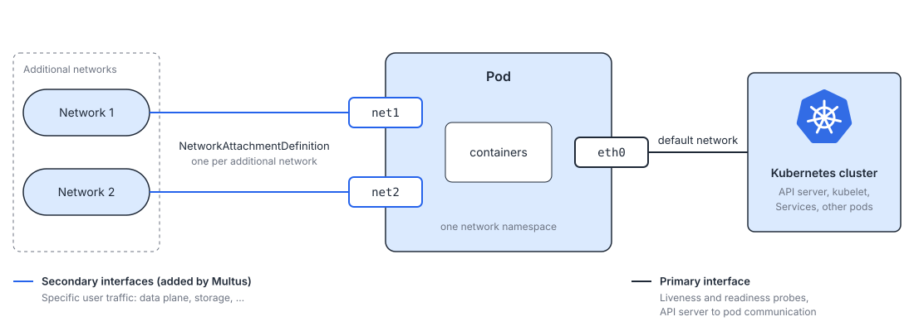

# Multus CNI

Multus CNI enables attaching multiple network interfaces to pods in Kubernetes. It acts as a "meta-plugin": a CNI plugin that calls other CNI plugins, so a pod can be multi-homed.

Multus follows the Kubernetes Network Custom Resource Definition De-facto Standard to describe additional network attachments.

## Where to start

New to Multus? Follow the [Learning path](learning-path/README.md): a staged route from CNI basics, through a hands-on lab on a local cluster, to network design and the code.

If you already know what you are looking for:

* [Quickstart Guide](quickstart.md) - install Multus and attach a second interface to a pod.
* [How to use](how-to-use.md) - complete usage guide.
* [Configuration reference](configuration.md) - all configuration options.
* [Thick plugin](thick-plugin.md) - client/server deployment mode.
* [Device resource assignment](device-resource-assignment.md) - using device plugin resources.
* [Network attachment patterns](network-patterns/README.md) - popular plugin combinations (macvlan, ipvlan, bridge, SR-IOV, sbr, ...) with pros and cons.
* [Development and support](development.md) - building, testing and troubleshooting.
