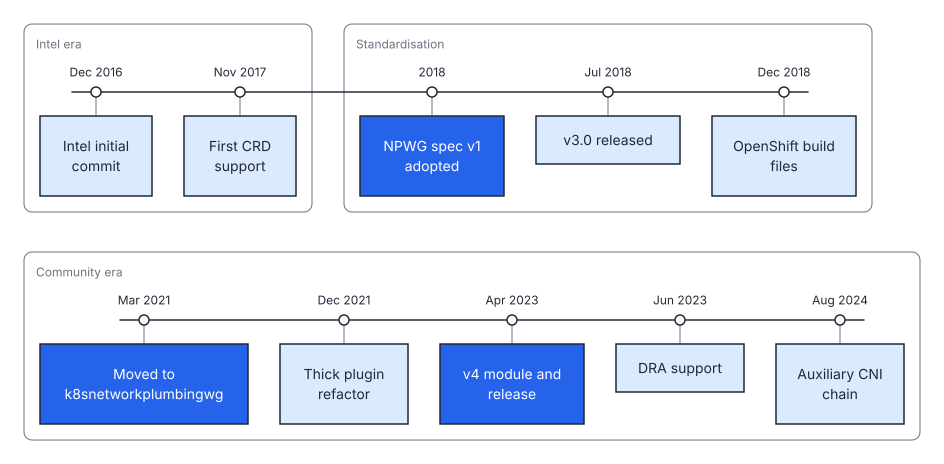

# History of Multus CNI

Multus started in December 2016 as a small Intel experiment to give Kubernetes pods more than one network interface. Today it is the reference implementation of the Kubernetes Network Plumbing Working Group (NPWG) multi-network standard, and every OpenShift cluster ships it through a Red Hat-maintained fork.

This section traces that path:

| Page | What it covers |
| --- | --- |
| [Upstream history](upstream.md) | The five eras of the upstream project, from the Intel prototype to the v4 thick plugin and DRA |
| [The OpenShift fork](openshift-fork.md) | Why `openshift/multus-cni` exists, how it stays in sync with upstream, and what it carries |

## Timeline at a glance

<!-- svgdog milestones
version: 1
theme: docs-auto
diagram: timeline
title: Multus CNI milestones
description: From the Intel initial commit in 2016, through the NPWG standard, v3.0, the move to the k8snetworkplumbingwg organization, the v4 thick plugin and DRA, to auxiliary CNI chains in 2024.
nodes:
  - { id: init, label: Intel initial commit, when: Dec 2016 }
  - { id: crd, label: First CRD support, when: Nov 2017 }
  - { id: npwg, label: NPWG spec v1 adopted, when: 2018, emphasis: true }
  - { id: v3, label: v3.0 released, when: Jul 2018 }
  - { id: ocp, label: OpenShift build files, when: Dec 2018 }
  - { id: org, label: Moved to k8snetworkplumbingwg, when: Mar 2021, emphasis: true }
  - { id: thick, label: Thick plugin refactor, when: Dec 2021 }
  - { id: v4, label: v4 module and release, when: Apr 2023, emphasis: true }
  - { id: dra, label: DRA support, when: Jun 2023 }
  - { id: aux, label: Auxiliary CNI chain, when: Aug 2024 }
groups:
  - { id: intel, label: Intel era, members: [init, crd] }
  - { id: std, label: Standardisation, members: [npwg, v3, ocp] }
  - { id: comm, label: Community era, members: [org, thick, v4, dra, aux] }
-->

## Key facts

| Fact | Value | Evidence |
| --- | --- | --- |
| First commit | 13 Dec 2016, Kuralamudhan Ramakrishnan (Intel) | `64e8857e Initial commit` |
| Original home | `Intel-Corp/multus-cni`, later `intel/multus-cni` | Merge commits from `Intel-Corp/` branches (2017), `github.com:intel/multus-cni` (2018) |
| Current upstream home | `github.com/k8snetworkplumbingwg/multus-cni` | `118cc629 Update organization name due to ownership change` (16 Mar 2021) |
| Go module path | `gopkg.in/k8snetworkplumbingwg/multus-cni.v4` | `4eac6603` (gopkg.in, 2020), `1b01e3e4` (v4, Apr 2023) |
| OpenShift fork | `github.com/openshift/multus-cni` (this repository's lineage) | `Dockerfile.openshift`, `OWNERS`, `.ci-operator.yaml` |
| Commits in this history | ≈1,500 | `git rev-list --count HEAD` |
| Most active authors | Tomofumi Hayashi, Doug Smith, Dan Williams, Kuralamudhan Ramakrishnan | `git shortlog -sn --no-merges` |

### Activity per year

Commits per year in this repository, which contains the upstream history plus the OpenShift downstream commits:

| Year | Commits | What was happening |
| --- | --- | --- |
| 2016 | 7 | Prototype |
| 2017 | 63 | Intel-only development, first CRD ideas |
| 2018 | 277 | **Peak:** NPWG standard, v3.0, Red Hat joins, readiness and namespace isolation |
| 2019 | 205 | Go modules, `default-route`, OpenShift 4 adoption |
| 2020 | 146 | Stabilisation, gopkg.in module path |
| 2021 | 139 | Org transfer, init containers, start of thick plugin |
| 2022 | 172 | Thick plugin hardening, multus-daemon |
| 2023 | 153 | v4.0 release, DRA |
| 2024 | 155 | Auxiliary CNI chain, MicroShift build |
| 2025 | 57 | Maintenance |
| 2026 | 143 | Kubernetes 1.35 rebase, frequent downstream syncs |

> **Method.** Everything in this section that carries a commit hash comes from the git history of this repository. Facts about the NPWG and OpenShift releases come from public talks and Red Hat documentation, linked in the pages. The repository has no tags, so release dates come from the commits that prepared each release.
