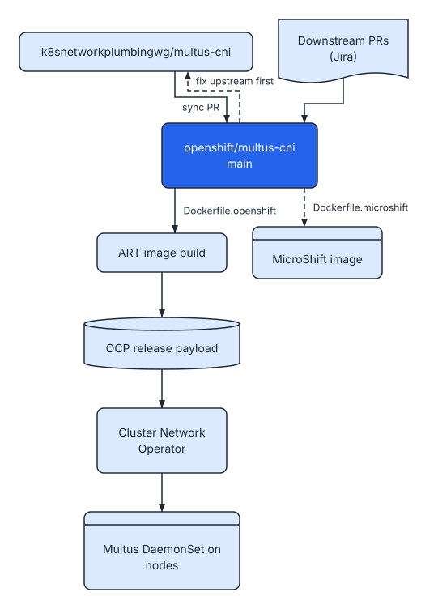
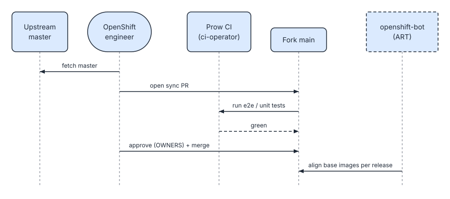

# The OpenShift fork

OpenShift Container Platform (OCP) 4 relies on Multus. Every OCP cluster runs it, deployed by the **Cluster Network Operator (CNO)**, to provide additional networks to pods. Red Hat builds the Multus image from its own repository, **`github.com/openshift/multus-cni`**. That repository is a long-lived downstream fork of `k8snetworkplumbingwg/multus-cni`, and this checkout is a copy of it.

## Why a fork exists

The fork is not a divergent product. Nearly all functional changes are made upstream first. The fork exists because OpenShift has to:

1. **Build on Red Hat's toolchain.** Images are built with the OCP builder (`registry.ci.openshift.org/ocp/builder:rhel-9-golang-…`) on a RHEL base, with `CGO_ENABLED=1` and `GOFLAGS=-mod=readonly` (`Dockerfile.openshift`, `857f2df5` "use readonly module mode in downstream images"). CGO is the usual OpenShift requirement for FIPS-validated crypto.
2. **Run OpenShift's CI and review process.** Prow (`.ci-operator.yaml`, added Jun 2021 by `openshift-ci-robot`) and an `OWNERS` file with the OpenShift networking team as approvers (component "Networking", subcomponent "multus").
3. **Tie changes to OpenShift release tracking.** Downstream PRs reference Jira: about 43 `OCPBUGS`, 14 `CORENET` and 2 `USHIFT` issue keys appear in this history.
4. **Control timing.** Upstream fixes are pulled in when an OpenShift release needs them, and backported per release branch.
5. **Carry packaging that upstream doesn't need:** `Dockerfile.microshift` for MicroShift (`41a92dbb`, USHIFT-2218, Feb 2024), `.snyk` scan exclusions (Feb 2024) and `.coderabbit.yaml` review config.

## How code flows

<!-- svgdog fork-flow
version: 1
theme: docs-auto
diagram: flow
direction: down
title: From upstream commit to an OpenShift cluster
description: Changes land in k8snetworkplumbingwg/multus-cni, are merged into openshift/multus-cni by sync PRs, built by ART into the OCP release payload, and deployed to clusters by the Cluster Network Operator.
nodes:
  - { id: up, label: k8snetworkplumbingwg/multus-cni, kind: service }
  - { id: fork, label: openshift/multus-cni main, kind: service, emphasis: true }
  - { id: carry, label: Downstream PRs (Jira), kind: document }
  - { id: art, label: ART image build, kind: service }
  - { id: payload, label: OCP release payload, kind: datastore }
  - { id: cno, label: Cluster Network Operator, kind: service }
  - { id: cluster, label: Multus DaemonSet on nodes, kind: client }
  - { id: ushift, label: MicroShift image, kind: client }
edges:
  - "up -> fork: sync PR"
  - "carry -> fork"
  - "fork -> art: Dockerfile.openshift"
  - "art -> payload"
  - "payload -> cno"
  - "cno -> cluster"
  - "fork --> ushift: Dockerfile.microshift"
  - "fork --> up: fix upstream first"
-->

## The sync process

<!-- svgdog sync-sequence
version: 1
theme: docs-auto
diagram: sequence
title: A downstream sync
description: An engineer merges upstream master into a sync branch, Prow CI tests it, an OWNERS approver merges it into the fork's main branch, and ART rebuilds the image; the ART bot also keeps base images aligned per release.
nodes:
  - { id: up, label: Upstream master, kind: service }
  - { id: eng, label: OpenShift engineer, kind: actor }
  - { id: ci, label: Prow CI (ci-operator), kind: service }
  - { id: fork, label: Fork main, kind: service }
  - { id: bot, label: openshift-bot (ART), kind: external }
edges:
  - "eng -> up: fetch master"
  - "eng -> fork: open sync PR"
  - "fork -> ci: run e2e / unit tests"
  - { from: ci, to: fork, label: green, style: async }
  - { id: merge, from: eng, to: fork, label: approve (OWNERS) + merge }
  - "bot -> fork: align base images per release"
-->

What the history shows about this process:

* **Sync merges** say "Merge remote-tracking branch 'upstream/master'", "Merge plumbing-upstream/master into OpenShift main", "sync_upstream" or "downstream-sync". The first is `673cbc40` (#57, Apr 2020, Doug Smith). Sync merges per year: 4 (2020), 2 (2021), 2 (2022), 11 (2023), 7 (2024), 4 (2025) and 11 (2026). Syncs have become more frequent, which keeps each one small.
* **Kubernetes rebases** are done in both places: for example "multus-cni kube 1.35 rebase" landed upstream (#1487) and downstream (#281) in March 2026.
* **The ART bot** (`openshift-bot`, commits by "AOS Automation Release Team") opens PRs that keep `Dockerfile.openshift` base images consistent with `ocp-build-data`. The first is #77 (Aug 2020); a recent one aligns with OCP 4.21 (#272, Nov 2025).
* **PR numbering** shows where a change was reviewed: low numbers (#2xx–#3xx) are fork PRs, and #1xxx are upstream PRs brought in by a sync.

## Lineage of the downstream build files

| File | Added | By | Purpose |
| --- | --- | --- | --- |
| `Dockerfile.rhel` | Dec 2018 (`e5e020f6`) | dougbtv | First OpenShift (RHEL) image build, later replaced |
| `Dockerfile.openshift` | Jan 2019 (`7174b9ac`) | dougbtv | Current OpenShift image build |
| `OWNERS` | Feb 2019 (`faae208b`) | dougbtv | Prow reviewers and approvers |
| `.ci-operator.yaml` | Jun 2021 (`986c24af`) | openshift-ci-robot | CI build root image |
| `.snyk` | Feb 2024 (`2393c216`) | — | Security scan exclusions |
| `Dockerfile.microshift` | Feb 2024 (`41a92dbb`) | Patryk Matuszak | MicroShift image (USHIFT-2218) |

## Upstream vs OpenShift deployment

| Aspect | Upstream | OpenShift |
| --- | --- | --- |
| Install | `deployments/multus-daemonset*.yml` | Deployed and reconciled by the CNO, not editable by hand |
| Default network | Any CNI | OVN-Kubernetes (OpenShift SDN in older releases) |
| Additional networks | You create `NetworkAttachmentDefinition`s | NADs directly, **or** `spec.additionalNetworks` in the CNO config, which creates and owns the NADs |
| Image | `ghcr.io/k8snetworkplumbingwg/multus-cni` | Built by ART from `Dockerfile.openshift` and shipped in the release payload |
| Support | Community | Red Hat, tracked in Jira (OCPBUGS) |
| Related components | whereabouts, SR-IOV operator (separate projects) | Forks of these ship with OCP too (whereabouts, SR-IOV Network Operator, multi-networkpolicy) |

## Practical guidance for contributors

1. **Fix upstream first.** Open the PR against `k8snetworkplumbingwg/multus-cni`. It reaches OpenShift with the next sync, or you can cherry-pick it if a release needs it sooner.
2. **Only open fork-only PRs for downstream concerns:** build files, CI, OpenShift-specific behaviour, or urgent backports. Reference a Jira key in the title.
3. **Keep syncs small and frequent.** The 2023 and 2026 cadence (about one per month) avoids large conflict-heavy rebases.
4. **Don't change the vendored or `go.mod` state downstream only.** `-mod=readonly` builds fail if `vendor/` and `go.mod` disagree.

## Sources

* Git history of this repository (commit hashes and PR numbers above).
* Red Hat OpenShift documentation, "Multiple networks": [4.4](https://docs.redhat.com/en/documentation/openshift_container_platform/4.4/html/networking/multiple-networks), [4.15](https://docs.redhat.com/en/documentation/openshift_container_platform/4.15/html/networking/multiple-networks). Covers CNO-managed additional networks, NADs and `net1…netN` naming.
* [Red Hat Jira OCPSTRAT-328](https://issues.redhat.com/browse/OCPSTRAT-328) on adopting Multus 4.0 in OpenShift.
