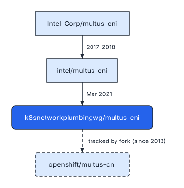

# Upstream history

The upstream project falls into five eras. Each era changed who owned Multus, how it was configured, or how it ran on the node.

<!-- svgdog ownership
version: 1
theme: docs-auto
diagram: flow
direction: down
title: Where the upstream repository lived
description: Multus moved from the Intel-Corp GitHub organisation to intel, and in March 2021 to the community-owned k8snetworkplumbingwg organisation; the OpenShift fork, which dates from 2018, now tracks it.
nodes:
  - { id: intelcorp, label: Intel-Corp/multus-cni, kind: box }
  - { id: intel, label: intel/multus-cni, kind: box }
  - { id: npwg, label: k8snetworkplumbingwg/multus-cni, kind: service, emphasis: true }
  - { id: ocp, label: openshift/multus-cni, kind: external }
edges:
  - "intelcorp -> intel: 2017-2018"
  - "intel -> npwg: Mar 2021"
  - "npwg --> ocp: tracked by fork (since 2018)"
-->

## Era 1: Intel prototype (Dec 2016 – 2017)

* **13 Dec 2016:** Kuralamudhan Ramakrishnan creates the repository (`64e8857e`). The first year of commits is mostly README work plus one fix: "clear plugins after the failure" (`136470b2`, Feb 2017).
* **Configuration model:** a static `delegates` list in the CNI config file on each node. Every pod got the same set of interfaces. There was no Kubernetes API involvement.
* **Jun 2017:** glide vendoring (`402b43e0`) and a sample kubeconfig (`a9424362`), the first step towards reading per-pod configuration from Kubernetes.
* **Nov 2017:** a "multus crd usage diagram" (`a9a0e808`): Multus experiments with its own Network CRD so that pods can choose networks.

**Why it mattered:** NFV and telco workloads, Intel's main audience (SR-IOV, DPDK), needed separate data-plane, control and management interfaces. Kubernetes' model of one network per pod couldn't express that.

## Era 2: Standardisation with the NPWG (2018)

* At **KubeCon North America 2017** Red Hat, Intel and others form the **Kubernetes Network Plumbing Working Group**. Its goal is to standardise multi-network attachments outside Kubernetes core, using a CRD.
* **Jan 2018:** "networking plumbing wg crd changes" (`45a17f78`) and "Updates to API endpoint for standardized CRD" (`85465286`). Multus becomes the reference implementation of the `NetworkAttachmentDefinition` CRD in the `k8s.cni.cncf.io` group.
* **May 2018:** the NPWG de-facto standard v1 is released. Multus merges the `network-plumbing-working-group-crd-change` branch (`8f15282d`).
* **Jul 2018:** **v3.0** README (`b4a1a2ec`). The `Plugin` field is removed from `NetworkAttachmentDefinition` (`6e440b4f`), and the client uses `InClusterConfig` when run as a DaemonSet (`42e68949`).
* **Red Hat engineers become the main maintainers.** Doug Smith (`dougbtv`) and Tomofumi Hayashi (`s1061123`) contribute most of the merged PRs from 2018 onwards: 75 and 119 merge commits respectively.
* **Oct–Dec 2018:** features for production clusters: default-network **readiness indicator** (`ae9a1a5c`) and **namespace isolation** (`de4bed7a`).

## Era 3: Production hardening (2019 – 2020)

* **Jan 2019:** OpenShift-style Dockerfile (`7174b9ac`), and `OWNERS` for Prow-based review (`faae208b`, Feb 2019). See [The OpenShift fork](openshift-fork.md).
* **May 2019:** libcni 0.7.0 / CNI spec 0.4.0 (`e723aabc`).
* **Jun 2019:** migrated from glide to **Go modules** (`de1c1c78`).
* **Aug–Oct 2019:** `default-route` (gateway) in the network selection element (`165e23b7`, `3a9dd7ed`). See [Routing](../network-patterns/routing.md).
* **May 2020:** module path `gopkg.in/intel/multus-cni.v3` (`4eac6603`) gives stable, versioned imports for consumers.

## Era 4: Community ownership and the thick plugin (2021 – 2023)

* **Mar 2021:** images move to `ghcr.io` (`784fecfa`, `20049ded`), and the repository moves to the **`k8snetworkplumbingwg`** organisation (`118cc629` "Update organization name due to ownership change"). Multus is now owned by the working group rather than one vendor.
* **Oct 2021:** the entrypoint script is replaced with init containers (#718, `8ba2accb`).
* **Dec 2021:** **thick plugin** refactor by Miguel Duarte Barroso (`fb31217e`). A long-running `multus-daemon` and a thin `multus-shim` binary replace the per-call binary. 2022 is spent hardening it (`d4a30c38`, `0a144e59`, `4180f884` "Refine multus-daemon config").
* **Apr 2023:** module path changes to `gopkg.in/k8snetworkplumbingwg/multus-cni.v4` "for v4 release" (`1b01e3e4`). **v4.0** makes the thick plugin a first-class deployment, and the old model is renamed "thin plugin". See [Thick plugin](../thick-plugin.md).
* **Jun 2023:** initial **Dynamic Resource Allocation** support (`40378cab`), released in v4.1.

## Era 5: Composability and maintenance (2024 – today)

* **Aug 2024:** **auxiliary CNI chain** with subdirectory-based CNI configuration loading (`528d4f15`, `8e8692ee`), with e2e tests added in Apr 2025 (`4104fea9`). See [`auxiliaryCNIChainName`](../configuration.md).
* **2024–2026:** Kubernetes and Go bumps, security fixes (for example "Validate command file paths after Kubernetes bump", `ccc5c23b`), `--force-config-watch` (#1532) and priority class fixes (#1556).

## How the configuration model evolved

| Era | How a pod got extra interfaces |
| --- | --- |
| 2016–2017 | Static `delegates` in `/etc/cni/net.d`, the same for every pod |
| Late 2017 | Multus-specific Network CRD + pod annotation |
| 2018+ | NPWG `NetworkAttachmentDefinition` + `k8s.v1.cni.cncf.io/networks` annotation (still current) |
| 2018+ | `clusterNetwork` / `defaultNetworks` replace `delegates` as the recommended form |
| 2019+ | Rich JSON selection: `ips`, `mac`, `interface`, `default-route`, later `cni-args` |
| 2023+ | Devices via the device plugin **or** DRA resource claims |

## Sources

* Git history of this repository (commit hashes above).
* D. Williams, D. Smith (Red Hat), [*Everyone Gets a Data Plane! Multi-Networking Kubernetes with the NPWG Spec*](https://raw.githack.com/mm-k8s-ug/kubecon-slides/master/slides/2018-kubecon-na/Everyone%20Gets%20a%20Data%20Plane%21%20Multi-Networking%20Kubernetes%20with%20the%20NPWG%20Spec%20-%20Dan%20Williams%20&%20Doug%20Smith,%20Red%20Hat%20-%20Kubecon_%20Everyone%20Gets%20a%20Data%20Plane%21%20Multi-Networking%20Kubernetes%20with%20the%20NPWG%20Spec.pdf), KubeCon NA 2018. Covers NPWG formation and the v1 spec timeline.
* [Original Intel repository](https://github.com/intel/multus-cni) and [current upstream](https://github.com/k8snetworkplumbingwg/multus-cni).
* [v3.0 release](https://newreleases.io/project/github/k8snetworkplumbingwg/multus-cni/release/v3.0) and the [v4 Go package](https://pkg.go.dev/gopkg.in/k8snetworkplumbingwg/multus-cni.v4@v4.0.2).
