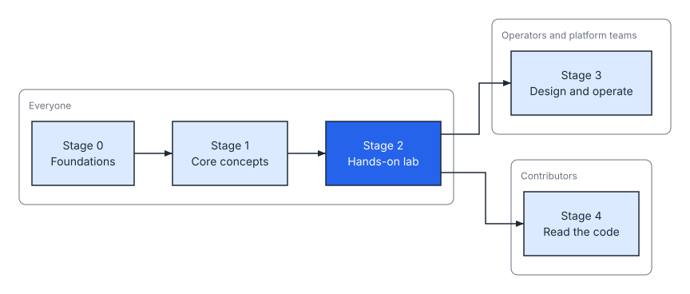

# Learning path

Multus looks small from the outside: one DaemonSet, one custom resource and one pod annotation. Getting comfortable with it still takes some care, because it sits on top of three other things: Linux networking, the CNI plugin model and the Kubernetes network model.

This chapter is a guided route through that material. It tells you what to learn, in which order, what to try with your own hands, and how to tell that you are ready for the next step. It does not replace the rest of the documentation; it puts it in order.

## The path at a glance

<!-- svgdog path-map
version: 1
theme: docs-auto
diagram: flow
direction: right
title: The Multus CNI learning path
description: Five stages. Foundations, core concepts and the hands-on lab are for everyone; after the lab the path splits into designing and operating secondary networks, and reading the code.
nodes:
  - { id: s0, label: "Stage 0\nFoundations" }
  - { id: s1, label: "Stage 1\nCore concepts" }
  - { id: s2, label: "Stage 2\nHands-on lab", emphasis: true }
  - { id: s3, label: "Stage 3\nDesign and operate" }
  - { id: s4, label: "Stage 4\nRead the code" }
groups:
  - { id: all, label: Everyone, members: [s0, s1, s2] }
  - { id: ops, label: Operators and platform teams, members: [s3] }
  - { id: dev, label: Contributors, members: [s4] }
edges:
  - "s0 -> s1"
  - "s1 -> s2"
  - "s2 -> s3"
  - "s2 -> s4"
-->

| Stage | You learn | You are done when you can | Time |
| --- | --- | --- | --- |
| [0. Foundations](foundations.md) | Network namespaces, the Kubernetes network model, how a CNI plugin is called | Explain what the container runtime does to give a pod its `eth0` | 45 min |
| [1. Core concepts](concepts.md) | Meta plugin, default network, NetworkAttachmentDefinition, the two annotations, thin and thick | Sketch what happens between "pod scheduled" and "pod has `net1`" | 30 min |
| [2. Hands-on lab](first-lab.md) | A local cluster with Multus, and two pods talking over a secondary network | Attach a network to a pod and prove which interface the traffic used | 60 to 90 min |
| [3. Design and operate](design-and-operate.md) | Choosing plugins and IPAM, routing, Multus options, troubleshooting | Review a NetworkAttachmentDefinition and predict how it behaves | 2 to 3 h |
| [4. Read the code](code-tour.md) | Repository layout, the path of a CNI ADD through the code, build and tests | Find the function behind a given behaviour and run its tests | 2 h |

After the lab, the optional [Lab follow-up: Test Multus configurations](config-lab.md) shows how to compare annotations, daemon options and deployment types with checks that pass or fail.

Keep the [Glossary and cheat sheet](glossary.md) open while you work through the stages.

## Pick your track

Stages 0 to 2 are the common trunk. What you do after the lab depends on why you are here.

| You are | Follow | You can skip |
| --- | --- | --- |
| An application developer who was told "add this annotation to your pod" | Stage 1, then Parts 3 and 4 of the Stage 2 lab | Stage 0 beyond its summary, Stages 3 and 4 |
| A platform engineer who will offer secondary networks to teams | Stages 0, 1, 2 and 3, in order | Stage 4, until a problem takes you into the code |
| A contributor or reviewer | Stages 0, 1 and 2, then Stage 4 | Most of Stage 3: read only [Building blocks](../network-patterns/building-blocks.md) and [Multus deployment options](../network-patterns/deployment-options.md) |
| An OpenShift user | The platform engineer track, then [The OpenShift fork](../history/openshift-fork.md) | Installing Multus yourself: on OpenShift the Cluster Network Operator deploys and reconciles it |

> **OpenShift note.** Do the Stage 2 lab on a local kind cluster, as written. It teaches the same concepts, and it keeps experiments away from a cluster where Multus is managed for you.

## How each stage is built

Every stage page has the same four parts:

* **Goal**: what you can do afterwards.
* **Learn**: the ideas, each with a link to the page that covers it in depth.
* **Do**: something to run or to look up.
* **Check yourself**: a few questions, with the answers hidden behind a click. If you can answer them without looking, move on.

Do not skip the lab. Most Multus confusion disappears the first time you see `net1` appear in a pod and read the `network-status` annotation next to it.

## What you need

* **Kubernetes basics**: pods, namespaces, and `kubectl apply`, `get`, `describe`, `exec` and `logs`.
* **Linux networking basics**: you can read the output of `ip addr` and `ip route`.
* **For the lab**: Docker, [kind](https://kind.sigs.k8s.io/), `kubectl`, and about 4 GB of free memory. No cloud account and no special hardware.
* **For Stage 4**: Go (the version in `go.mod`) and a Linux machine or VM, because the unit tests create network namespaces.

## Where the existing pages fit

| Page | Read it in |
| --- | --- |
| [Introduction](../README.md) | Stage 1 |
| [Quickstart Guide](../quickstart.md) | Stage 1 (Key Concepts), Stage 2 (as a second run-through on your own cluster) |
| [How to use](../how-to-use.md) | Stage 3, as a reference for manual installation and annotation forms |
| [Configuration](../configuration.md) | Stage 3 |
| [Thick plugin](../thick-plugin.md) | Stage 1 (first section), Stage 4 (all of it) |
| [Device resource assignment](../device-resource-assignment.md) | Stage 3, only if you use SR-IOV or other device plugins |
| [Network Attachment Patterns](../network-patterns/README.md) | Stage 3: this is the core reading of that stage |
| [History of Multus CNI](../history/README.md) | Any time. It explains why some options exist in two forms |
| [Development and support](../development.md) | Stage 4 |
