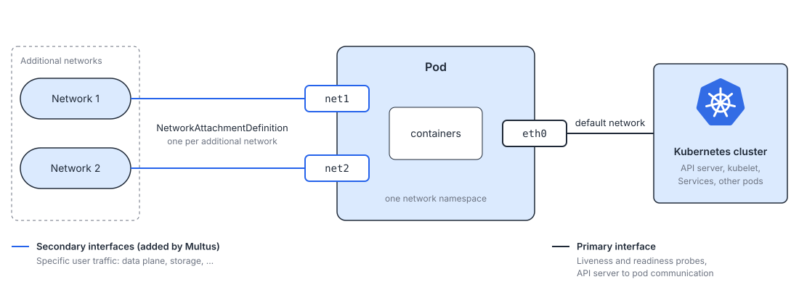

# Stage 1: Core concepts

**Goal:** sketch what happens between "pod scheduled" and "pod has `net1`", and name the three objects involved.

**Time:** 30 minutes.

## The model in one sentence

**Multus is a CNI plugin whose only job is to call other CNI plugins.**

The container runtime believes it is configuring one network, as in [Stage 0](foundations.md). Multus receives that single call and turns it into several: one for the cluster network, plus one for every extra network the pod asked for.



## Learn: eight ideas

### 1. Meta plugin and delegates

Multus creates no interface itself. The plugins it calls are its **delegates**. A delegate is an ordinary CNI configuration: `macvlan`, `bridge`, `sriov`, or the cluster network's own plugin.

### 2. The default network

The first delegate is always the cluster network from Stage 0. Documentation calls it the **default network**, the **cluster network** or the primary network; the code calls it the *master plugin*. It creates `eth0`, and its result is the one Multus hands back to the runtime. That is why the pod IP that Kubernetes knows is always the `eth0` address.

### 3. NetworkAttachmentDefinition

A `NetworkAttachmentDefinition` (NAD, short names `nad` and `net-attach-def`) is a namespaced custom resource that stores one CNI configuration under a name:

```yaml
apiVersion: k8s.cni.cncf.io/v1
kind: NetworkAttachmentDefinition
metadata:
  name: lab-net
spec:
  config: |
    {
      "cniVersion": "1.0.0",
      "name": "lab-net",
      "type": "macvlan",
      "master": "eth0",
      "mode": "bridge",
      "ipam": { "type": "host-local", "subnet": "10.10.0.0/24" }
    }
```

Creating a NAD changes nothing on any node. It is a recipe that Multus reads later, when a pod refers to it.

### 4. The network selection annotation

A pod asks for extra networks with the annotation `k8s.v1.cni.cncf.io/networks`. It has two forms:

| Form | Example | Use it when |
| --- | --- | --- |
| Text | `lab-net` | The name is all you need |
| Text, full | `storage/fast@data0, lab-net` | You also need a namespace (`storage/`) or an interface name (`@data0`) |
| JSON | `[{ "name": "lab-net", "ips": ["10.10.0.15/24"] }]` | You pass per-pod values: IPs, MAC, default route and more |

All fields of the JSON form are listed in [Building blocks](../network-patterns/building-blocks.md#network-selection-annotation-fields).

### 5. Interface names

`eth0` belongs to the default network. Extra interfaces are named `net1`, `net2` and so on, where the number is the position of the attachment in the list. A requested name (`@data0`, or `"interface"` in JSON) replaces the generated one.

### 6. The network status annotation

After the delegates have run, Multus writes what it attached to the pod's `k8s.v1.cni.cncf.io/network-status` annotation: network name, interface, IPs and MAC for each attachment, with `"default": true` on the cluster network. This annotation is the first place to look when you want to know what a pod really got.

### 7. Secondary networks are invisible to Kubernetes

Kubernetes knows one address per pod. Everything it builds on that address ignores `net1`:

* Services and kube-proxy do not load-balance to it.
* Liveness and readiness probes arrive on `eth0`.
* NetworkPolicy does not filter it. The separate [multi-networkpolicy](https://github.com/k8snetworkplumbingwg/multi-networkpolicy) project exists for this.
* Cluster DNS does not resolve it.

A secondary network gives you connectivity, not Kubernetes features.

### 8. Thin and thick

Multus can run in two ways. The concepts above are identical in both.

| | Thin | Thick |
| --- | --- | --- |
| What the runtime executes | `multus`, which does all the work in that process | `multus-shim`, which forwards the request over a Unix socket |
| Long-running part | None | `multus-daemon`, one pod per node |
| Recommended for | Small or resource-constrained setups | Most clusters; it is the default in the quickstart |

Details are in [Thick plugin](../thick-plugin.md) and [Multus deployment options](../network-patterns/deployment-options.md#thin-vs-thick-plugin).

## What happens when a pod is created

<!-- svgdog multus-add
version: 1
theme: docs-auto
diagram: sequence
title: What Multus does on a CNI ADD
description: The runtime calls Multus once. Multus reads the pod and its NetworkAttachmentDefinitions from the API server, calls the default network plugin for eth0 and one delegate per attachment for net1, writes the network-status annotation and returns the default network result.
nodes:
  - { id: runtime, label: Container runtime, kind: client }
  - { id: multus, label: Multus, kind: service, emphasis: true }
  - { id: api, label: Kubernetes API, kind: service }
  - { id: defcni, label: "Default network\nplugin", kind: service }
  - { id: nadcni, label: "Delegate plugin\n(for example macvlan)", kind: service }
edges:
  - "runtime -> multus: ADD"
  - { id: getpod, from: multus, to: api, label: get Pod and annotations }
  - { id: getnad, from: multus, to: api, label: get NetworkAttachmentDefinition }
  - "multus -> defcni: ADD eth0"
  - "multus -> nadcni: ADD net1"
  - { id: status, from: multus, to: api, label: write network-status }
  - { id: result, from: multus, to: runtime, label: result of eth0, style: async }
-->


1. The runtime runs the first configuration in `/etc/cni/net.d`, which is now the Multus one.
2. Multus looks up the pod and reads its `k8s.v1.cni.cncf.io/networks` annotation.
3. For every name in the annotation it fetches the NAD and turns it into a delegate.
4. It runs the delegates in order: the default network first (`eth0`), then each attachment (`net1`, `net2`, ...). If one fails, the ones that already ran are removed again and the pod does not start.
5. It writes the `network-status` annotation and returns the default network's result to the runtime.

When the pod is deleted, the same delegates receive `DEL` in reverse order.

## Three objects, three owners

| Object | Where it lives | Who usually owns it | How often it changes |
| --- | --- | --- | --- |
| Multus configuration | A file on every node, `/etc/cni/net.d/00-multus.conf`, generated by the Multus DaemonSet | Cluster administrator | Rarely |
| NetworkAttachmentDefinition | A namespaced object in the Kubernetes API | Network or platform team | Once per network |
| Network selection annotation | The pod template of a workload | Application team | Once per workload |

Most support questions are about the boundary between two of these rows. Knowing which object holds a setting tells you who can change it.

## What Multus is not

* **Not a network.** No packet passes through Multus. The data path is whatever the delegate built. If the Multus pod on a node is down, running pods keep their interfaces; only creating and deleting pods on that node is affected.
* **Not IPAM.** Addresses come from the IPAM plugin named in the NAD.
* **Not a policy engine.** See idea 7.
* **Not a way to make Services multi-network.** Traffic on `net1` is addressed by you, not by Kubernetes.

## Do

Reading, about 20 minutes:

1. [Introduction](../README.md) and the *Key Concepts* section of the [Quickstart Guide](../quickstart.md#key-concepts).
2. [The mental model in 60 seconds](../network-patterns/README.md#the-mental-model-in-60-seconds): the same story, seen from the plugin chain.
3. The first section of [Thick plugin](../thick-plugin.md), up to the diagram.
4. Optional: the [multi-network specification](https://github.com/k8snetworkplumbingwg/multi-net-spec) of the Network Plumbing Working Group, which defines the NAD and both annotations. Multus is its reference implementation.

## Check yourself

<details>
<summary>A pod in namespace <code>app</code> has the annotation <code>storage/fast@data0, mgmt</code>. Which NADs are used, and what are the interfaces called?</summary>

`fast` from namespace `storage` becomes `data0`. `mgmt` from the pod's own namespace `app` becomes `net2`, because it is the second attachment. Together with `eth0` the pod has three interfaces besides loopback.

</details>

<details>
<summary>Which interface do liveness probes use?</summary>

`eth0`. The kubelet probes the pod IP, and the pod IP is the default network's address.

</details>

<details>
<summary>Where do you look to confirm what Multus attached to a pod?</summary>

In the pod's `k8s.v1.cni.cncf.io/network-status` annotation, and in the pod's events, where Multus records an `AddedInterface` event per interface.

</details>

<details>
<summary>The Multus pod on a node crashes. What happens to <code>net1</code> in the pods already running there?</summary>

Nothing. CNI plugins only run when a pod is created or deleted. New pods on that node cannot start until Multus is back.

</details>

<details>
<summary>Can a Service send traffic to the <code>net1</code> addresses of its pods?</summary>

No. Endpoints are built from the pod IP, which is the `eth0` address.

</details>

<details>
<summary>Which binary does the container runtime execute in a thin deployment, and which in a thick one?</summary>

`multus` in a thin deployment, `multus-shim` in a thick one. The shim passes the request to `multus-daemon`.

</details>

**Next:** [Stage 2: Hands-on lab](first-lab.md)
