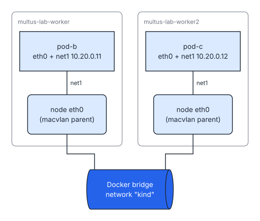

# Stage 2: Hands-on lab

**Goal:** attach a secondary network to a pod, and prove which interface the traffic used.

**Time:** 60 to 90 minutes, of which about 10 are spent waiting for downloads.

You will build a three-node Kubernetes cluster on your own machine, look at CNI before Multus is there, install Multus, and connect two pods on different nodes over a macvlan network.

<!-- svgdog topology
version: 1
theme: docs-auto
diagram: flow
direction: down
title: Lab topology
description: Two kind worker nodes are Docker containers on the same Docker bridge network. Each pod keeps eth0 on the cluster network and gets net1, a macvlan child of its node's eth0, so the two pods reach each other directly over the Docker bridge.
nodes:
  - { id: podb, label: "pod-b\neth0 + net1 10.20.0.11", kind: box }
  - { id: podc, label: "pod-c\neth0 + net1 10.20.0.12", kind: box }
  - { id: eth1, label: "node eth0\n(macvlan parent)", kind: service }
  - { id: eth2, label: "node eth0\n(macvlan parent)", kind: service }
  - { id: bridge, label: "Docker bridge network \"kind\"", kind: queue, emphasis: true }
groups:
  - { id: w1, label: multus-lab-worker, members: [podb, eth1] }
  - { id: w2, label: multus-lab-worker2, members: [podc, eth2] }
edges:
  - { from: podb, to: eth1, label: net1, arrow: none }
  - { from: podc, to: eth2, label: net1, arrow: none }
  - { from: eth1, to: bridge, arrow: none }
  - { from: eth2, to: bridge, arrow: none }
-->



## Before you start

You need Docker, [kind](https://kind.sigs.k8s.io/docs/user/quick-start/#installation), `kubectl` and `jq`.

> **Tested with** kind v0.27.0 (Kubernetes v1.32.2 nodes), CNI plugins v1.10.0 and the `snapshot-thick` Multus image, on Docker Desktop, in November 2026. Every command and output on this page comes from that run. Addresses, MAC addresses and pod name suffixes will differ on your machine.

> **Your kubectl context changes.** `kind create cluster` adds a context called `kind-multus-lab` to your kubeconfig and makes it the current one. Switch back when you are done, especially if you also work with real clusters.

## Part 1: A cluster without Multus

### 1.1 Create the cluster

```bash
cat <<EOF | kind create cluster --config=-
kind: Cluster
apiVersion: kind.x-k8s.io/v1alpha4
name: multus-lab
nodes:
  - role: control-plane
  - role: worker
  - role: worker
EOF

kubectl wait --for=condition=Ready nodes --all --timeout=180s
kubectl get nodes
```

All three nodes are `Ready`. Each node is a Docker container, so `docker exec` gives you a shell on it.

### 1.2 Look at CNI on a node

```bash
docker exec multus-lab-worker ls /etc/cni/net.d /opt/cni/bin
```

```text
/etc/cni/net.d:
10-kindnet.conflist

/opt/cni/bin:
host-local
loopback
portmap
ptp
```

One configuration and four plugins: this is everything the node needs for its cluster network. Print the configuration and compare it with the example in [Stage 0](foundations.md#3-cni-in-six-facts):

```bash
docker exec multus-lab-worker cat /etc/cni/net.d/10-kindnet.conflist
```

### 1.3 Be the container runtime

Now do by hand what the runtime does for every pod: create a namespace and call a plugin. Open a shell on the node:

```bash
docker exec -it multus-lab-worker bash
```

Inside the node, create a namespace and a small configuration:

```bash
ip netns add demo

cat > /tmp/demo.conf <<EOF
{
  "cniVersion": "1.0.0",
  "name": "demo",
  "type": "ptp",
  "ipam": { "type": "host-local", "subnet": "10.99.0.0/24" }
}
EOF
```

Call the plugin with the `ADD` verb. The environment variables are the ones from Stage 0:

```bash
CNI_COMMAND=ADD CNI_CONTAINERID=demo1 CNI_NETNS=/var/run/netns/demo \
CNI_IFNAME=eth0 CNI_PATH=/opt/cni/bin /opt/cni/bin/ptp < /tmp/demo.conf
```

The plugin answers with a JSON result:

```json
{
    "cniVersion": "1.0.0",
    "interfaces": [
        { "mac": "8e:f5:56:87:fb:b6", "name": "veth6b4c9f51" },
        { "mac": "06:98:f2:55:c4:e4", "name": "eth0", "sandbox": "/var/run/netns/demo" }
    ],
    "ips": [
        { "address": "10.99.0.2/24", "gateway": "10.99.0.1", "interface": 1 }
    ]
}
```

Check that it told the truth, then look at the state the IPAM plugin keeps:

```bash
ip -n demo addr show eth0
ls /var/lib/cni/networks/demo/
```

You see `10.99.0.2/24` on `eth0`, and a file named `10.99.0.2`: `host-local` remembers its allocations as files **on this node**. Remember that detail for experiment 5.1.

Tear it down the same way, with `DEL`, and leave the node:

```bash
CNI_COMMAND=DEL CNI_CONTAINERID=demo1 CNI_NETNS=/var/run/netns/demo \
CNI_IFNAME=eth0 CNI_PATH=/opt/cni/bin /opt/cni/bin/ptp < /tmp/demo.conf

ip netns del demo
rm /tmp/demo.conf
exit
```

You have just done, for one interface, exactly what Multus does several times per pod.

## Part 2: Install Multus

### 2.1 Add the reference CNI plugins

The lab uses `macvlan`, and the node does not have it (see 1.2). Multus only *calls* plugins; installing them on every node is a separate task. Download the reference plugins into each node:

```bash
CNI_PLUGINS_VERSION=v1.10.0
for node in $(kind get nodes --name multus-lab); do
  docker exec "$node" sh -c "curl -sSL https://github.com/containernetworking/plugins/releases/download/${CNI_PLUGINS_VERSION}/cni-plugins-linux-\$(dpkg --print-architecture)-${CNI_PLUGINS_VERSION}.tgz | tar -xz -C /opt/cni/bin"
done

docker exec multus-lab-worker ls /opt/cni/bin
```

The list now includes `macvlan`, `ipvlan`, `bridge`, `static`, `tuning`, `sbr` and others.

### 2.2 Deploy Multus

```bash
kubectl apply -f https://raw.githubusercontent.com/k8snetworkplumbingwg/multus-cni/master/deployments/multus-daemonset-thick.yml
kubectl -n kube-system rollout status daemonset/kube-multus-ds --timeout=300s
```

If you work from a clone of the repository, `kubectl apply -f deployments/multus-daemonset-thick.yml` does the same. The manifest creates the `NetworkAttachmentDefinition` CRD, RBAC objects, a ConfigMap with the daemon configuration, and the `kube-multus-ds` DaemonSet.

### 2.3 See what changed on the node

```bash
docker exec multus-lab-worker ls /etc/cni/net.d
docker exec multus-lab-worker cat /etc/cni/net.d/00-multus.conf
docker exec multus-lab-worker sh -c 'ls /opt/cni/bin | grep multus; ls /run/multus'
```

There are three changes:

| On the node | Meaning |
| --- | --- |
| `/etc/cni/net.d/00-multus.conf` | A new configuration that sorts before `10-kindnet.conflist`, so the runtime now calls Multus |
| `/opt/cni/bin/multus-shim` | The plugin binary the runtime executes (thick deployment) |
| `/run/multus/multus.sock` | The Unix socket on which the shim reaches `multus-daemon` |

The generated configuration, formatted for reading:

```json
{
  "cniVersion": "0.3.1",
  "name": "multus-cni-network",
  "type": "multus-shim",
  "clusterNetwork": "/host/etc/cni/net.d/10-kindnet.conflist",
  "capabilities": { "portMappings": true },
  "logLevel": "verbose",
  "logToStderr": true
}
```

`type` names the shim binary. `clusterNetwork` points at the configuration that used to be first: Multus found it and adopted it as the default network. The `/host` prefix is there because the path is read by the daemon, whose pod mounts the node's `/etc/cni/net.d` under `/host`.

Nothing has changed for existing or new pods yet. Without an annotation, Multus only runs the default network.

## Part 3: Your first attachment

### 3.1 Define the network

```bash
cat <<EOF | kubectl apply -f -
apiVersion: k8s.cni.cncf.io/v1
kind: NetworkAttachmentDefinition
metadata:
  name: lab-net
spec:
  config: |
    {
      "cniVersion": "1.0.0",
      "name": "lab-net",
      "type": "macvlan",
      "master": "eth0",
      "mode": "bridge",
      "ipam": {
        "type": "host-local",
        "subnet": "10.10.0.0/24"
      }
    }
EOF

kubectl get net-attach-def
```

`master` is the node interface that the macvlan interface is stacked on. On a kind node that is `eth0`; on real hardware you would name a dedicated NIC.

### 3.2 Create a pod that asks for it

```bash
cat <<EOF | kubectl apply -f -
apiVersion: v1
kind: Pod
metadata:
  name: pod-a
  annotations:
    k8s.v1.cni.cncf.io/networks: lab-net
spec:
  nodeSelector:
    kubernetes.io/hostname: multus-lab-worker
  containers:
  - name: shell
    image: alpine:3.22
    command: ["sleep", "infinity"]
EOF

kubectl wait --for=condition=Ready pod/pod-a --timeout=180s
```

### 3.3 Inspect the result

Interfaces and routes inside the pod:

```bash
kubectl exec pod-a -- ip -o -4 addr
kubectl exec pod-a -- ip route
```

```text
1: lo    inet 127.0.0.1/8 scope host lo ...
11: eth0    inet 10.244.1.2/24 brd 10.244.1.255 scope global eth0 ...
12: net1    inet 10.10.0.2/24 brd 10.10.0.255 scope global net1 ...

default via 10.244.1.1 dev eth0
10.10.0.0/24 dev net1 scope link  src 10.10.0.2
10.244.1.0/24 via 10.244.1.1 dev eth0  src 10.244.1.2
10.244.1.1 dev eth0 scope link  src 10.244.1.2
```

The pod has `net1`, and the default route still points at `eth0`. Only traffic for `10.10.0.0/24` uses the new interface.

> On Docker Desktop, a plain `ip addr` in the pod also lists devices such as `tunl0` and `gre0`. They come from the kernel of the Docker VM, not from Multus. The `-o -4` flags hide them because they have no IPv4 address.

What Multus recorded:

```bash
kubectl get pod pod-a -o jsonpath='{.metadata.annotations.k8s\.v1\.cni\.cncf\.io/network-status}' | jq
```

```json
[
  {
    "name": "kindnet",
    "interface": "eth0",
    "ips": ["10.244.1.2"],
    "mac": "f2:2b:06:6b:cf:84",
    "default": true,
    "dns": {}
  },
  {
    "name": "default/lab-net",
    "interface": "net1",
    "ips": ["10.10.0.2"],
    "mac": "4a:bc:4d:74:b0:65",
    "dns": {}
  }
]
```

What Kubernetes knows:

```bash
kubectl get pod pod-a -o wide
kubectl get events --field-selector involvedObject.name=pod-a \
  -o custom-columns=REASON:.reason,MESSAGE:.message
```

```text
NAME    READY   STATUS    RESTARTS   AGE   IP           NODE
pod-a   1/1     Running   0          6s    10.244.1.2   multus-lab-worker

REASON           MESSAGE
AddedInterface   Add eth0 [10.244.1.2/24] from kindnet
AddedInterface   Add net1 [10.10.0.2/24] from default/lab-net
```

The `IP` column shows the `eth0` address only. The second address exists in the pod and in the annotation, and nowhere else in Kubernetes.

## Part 4: Two pods across nodes

One pod proves the interface exists. Two pods on different nodes prove the network works. For that, every pod needs a unique address, so this part uses the `static` IPAM plugin and passes the address in the JSON form of the annotation.

```bash
cat <<EOF | kubectl apply -f -
apiVersion: k8s.cni.cncf.io/v1
kind: NetworkAttachmentDefinition
metadata:
  name: lab-static
spec:
  config: |
    {
      "cniVersion": "1.0.0",
      "name": "lab-static",
      "type": "macvlan",
      "master": "eth0",
      "mode": "bridge",
      "capabilities": { "ips": true },
      "ipam": { "type": "static" }
    }
---
apiVersion: v1
kind: Pod
metadata:
  name: pod-b
  annotations:
    k8s.v1.cni.cncf.io/networks: '[{ "name": "lab-static", "ips": ["10.20.0.11/24"] }]'
spec:
  nodeSelector:
    kubernetes.io/hostname: multus-lab-worker
  containers:
  - name: shell
    image: alpine:3.22
    command: ["sleep", "infinity"]
---
apiVersion: v1
kind: Pod
metadata:
  name: pod-c
  annotations:
    k8s.v1.cni.cncf.io/networks: '[{ "name": "lab-static", "ips": ["10.20.0.12/24"] }]'
spec:
  nodeSelector:
    kubernetes.io/hostname: multus-lab-worker2
  containers:
  - name: shell
    image: alpine:3.22
    command: ["sleep", "infinity"]
EOF

kubectl wait --for=condition=Ready pod/pod-b pod/pod-c --timeout=180s
```

`"capabilities": { "ips": true }` in the NAD is what allows the `ips` value from the annotation to reach the plugin. Without it the request is silently ignored; see [Building blocks](../network-patterns/building-blocks.md#requesting-a-specific-ipmac-per-pod).

Ping `pod-c` from `pod-b`, first over the secondary network, then over the cluster network:

```bash
kubectl exec pod-b -- ping -c 3 -I net1 10.20.0.12
kubectl exec pod-b -- ping -c 2 $(kubectl get pod pod-c -o jsonpath='{.status.podIP}')
```

```text
64 bytes from 10.20.0.12: seq=0 ttl=64 time=2.001 ms
...
64 bytes from 10.244.2.2: seq=0 ttl=62 time=1.555 ms
```

Both work, and the `ttl` values show that they took different paths. Over `net1` the reply arrives with `ttl=64`: the pods are neighbours on the same layer 2 segment, with no router in between. Over `eth0` it is `ttl=62`: the packet was routed by both nodes. That is the proof the goal of this stage asked for.

## Part 5: Experiments

Each experiment takes five to ten minutes. Do at least 5.1 and 5.3.

### 5.1 The host-local surprise

`pod-a` runs on the first worker with the address `10.10.0.2`. Start another pod on the **second** worker, on the same `lab-net` network:

```bash
cat <<EOF | kubectl apply -f -
apiVersion: v1
kind: Pod
metadata:
  name: pod-d
  annotations:
    k8s.v1.cni.cncf.io/networks: lab-net
spec:
  nodeSelector:
    kubernetes.io/hostname: multus-lab-worker2
  containers:
  - name: shell
    image: alpine:3.22
    command: ["sleep", "infinity"]
EOF

kubectl wait --for=condition=Ready pod/pod-d --timeout=180s
kubectl exec pod-a -- ip -o -4 addr show net1
kubectl exec pod-d -- ip -o -4 addr show net1
```

Both pods have `10.10.0.2`. Nothing reported an error. You saw the reason in 1.3: `host-local` keeps its state in files on each node, so two nodes hand out the same range independently. This is the most common mistake with secondary networks, and [Stage 3](design-and-operate.md#exercise-1-cluster-wide-addresses-with-whereabouts) fixes it.

### 5.2 Two attachments and a custom name

```bash
cat <<EOF | kubectl apply -f -
apiVersion: v1
kind: Pod
metadata:
  name: pod-e
  annotations:
    k8s.v1.cni.cncf.io/networks: lab-net, lab-net@data0
spec:
  containers:
  - name: shell
    image: alpine:3.22
    command: ["sleep", "infinity"]
EOF

kubectl wait --for=condition=Ready pod/pod-e --timeout=180s
kubectl get pod pod-e -o jsonpath='{.metadata.annotations.k8s\.v1\.cni\.cncf\.io/network-status}' \
  | jq -c '.[] | {name, interface, ips}'
```

```text
{"name":"kindnet","interface":"eth0","ips":["10.244.1.4"]}
{"name":"default/lab-net","interface":"net1","ips":["10.10.0.3"]}
{"name":"default/lab-net","interface":"data0","ips":["10.10.0.4"]}
```

The same NAD can be attached more than once, and `@data0` replaces the generated name.

### 5.3 Break it: a network that does not exist

```bash
cat <<EOF | kubectl apply -f -
apiVersion: v1
kind: Pod
metadata:
  name: pod-f
  annotations:
    k8s.v1.cni.cncf.io/networks: does-not-exist
spec:
  containers:
  - name: shell
    image: alpine:3.22
    command: ["sleep", "infinity"]
EOF

kubectl get pod pod-f
kubectl get events --field-selector involvedObject.name=pod-f \
  -o custom-columns=TYPE:.type,REASON:.reason,MESSAGE:.message
```

The pod stays in `ContainerCreating`, and the events say why:

```text
Warning   NoNetworkFound           cannot find a network-attachment-definition (does-not-exist) in namespace (default): ...
Warning   FailedCreatePodSandBox   Failed to create pod sandbox: ... plugin type="multus-shim" name="multus-cni-network" failed (add): ...
```

A pod that references a missing or broken network does not start with fewer interfaces. It does not start at all. `kubectl describe pod` and the events are the first place to look. Remove the pod with `kubectl delete pod pod-f`.

### 5.4 Read the Multus log

Find the Multus pod on the node where `pod-b` runs, and filter its log:

```bash
MULTUS_POD=$(kubectl -n kube-system get pods -l name=multus \
  --field-selector spec.nodeName=multus-lab-worker -o name)
kubectl -n kube-system logs $MULTUS_POD -c kube-multus | grep pod-b
```

You see one `ADD starting CNI request` line, one `Add:` line per interface (`eth0` first, then `net1`) with the delegate's full result, and `ADD finished CNI request`. Now delete the pod and run the same `logs` command again:

```bash
kubectl delete pod pod-b
```

The `Del:` lines appear in the opposite order: `net1` first, `eth0` last.

## Clean up

```bash
kind delete cluster --name multus-lab
```

This removes the three node containers and the `kind-multus-lab` context. If you had another context selected before the lab, switch back to it with `kubectl config use-context <name>`.

Keep the cluster if you continue with [Stage 3](design-and-operate.md): its exercises build on it.

## Check yourself

<details>
<summary>After installing Multus, why does the runtime call Multus and no longer kindnet directly?</summary>

The runtime uses the first file in `/etc/cni/net.d`, and `00-multus.conf` sorts before `10-kindnet.conflist`. Multus then calls kindnet itself, through `clusterNetwork`.

</details>

<details>
<summary>A pod is stuck in <code>ContainerCreating</code> with <code>failed to find plugin "macvlan"</code>. What is missing, and where?</summary>

The `macvlan` binary in `/opt/cni/bin` on the node where the pod was scheduled. A NAD exists once per cluster; the plugin binary must exist on every node.

</details>

<details>
<summary>Why did <code>pod-a</code> and <code>pod-d</code> get the same address?</summary>

`host-local` stores allocations in files on each node. Two nodes do not see each other's files, so both start at the first address of the range.

</details>

<details>
<summary>In Part 4, what would happen if the NAD did not declare <code>"capabilities": { "ips": true }</code>?</summary>

The `ips` value from the annotation would never reach the plugin, because a runtime value is only passed to a plugin that declares the matching capability.

</details>

<details>
<summary>How can you tell from inside a pod whether traffic to another pod went over the secondary network?</summary>

Bind the test to the interface (`ping -I net1`) and compare the result with the cluster network path. On a shared layer 2 network the TTL is not decremented; over the routed cluster network it is.

</details>

**Next:** [Stage 3: Design and operate](design-and-operate.md) if you will run secondary networks, or [Stage 4: Read the code](code-tour.md) if you want to change Multus.
