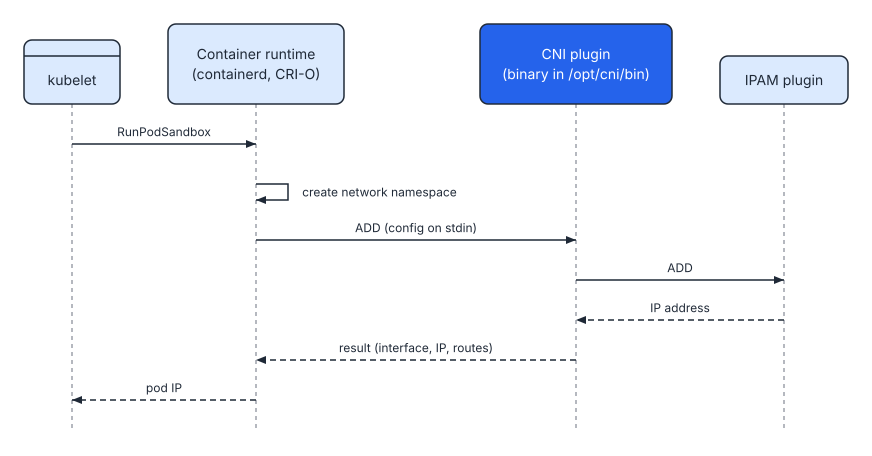

# Stage 0: Foundations

**Goal:** explain, without mentioning Multus, how a pod gets its network interface.

**Time:** 45 minutes. If you already write CNI configurations, read the summary and go straight to [Check yourself](#check-yourself).

Multus adds almost no networking of its own. It runs other CNI plugins and keeps track of what they did. Everything it does is easier to follow once the four ideas below are familiar.

## Summary

1. A pod is a Linux **network namespace**. It starts with nothing but a loopback device.
2. The **Kubernetes network model** gives every pod one IP address. Services, DNS, probes and NetworkPolicy all work on that one address.
3. A **CNI plugin** is an executable on the node. The container runtime runs it to create an interface in the pod's namespace.
4. The runtime does this **once per pod, for one network**. That is the gap Multus fills.

## Learn

### 1. A pod is a network namespace

A network namespace is a private copy of the Linux network stack: its own interfaces, addresses, routing table and firewall rules. All containers of a pod share one namespace, which is why they reach each other on `localhost`.

A new namespace is isolated. Something has to connect it to the outside, and there are only a few ways to do that:

| Technique | What ends up in the pod | Plugins that use it |
| --- | --- | --- |
| veth pair | One end of a virtual cable; the other end stays on the node | `ptp`, `bridge`, most cluster networks |
| Child of a node interface | A virtual interface stacked on a physical one | `macvlan`, `ipvlan`, `vlan` |
| Moved device | A real NIC or an SR-IOV Virtual Function, removed from the node | `host-device`, `sriov` |

The commands worth knowing are `ip addr`, `ip route`, `ip link` and `ip netns`.

### 2. The Kubernetes network model

Kubernetes makes three promises about pod networking:

* every pod gets its own IP address;
* pods reach each other on those addresses without NAT;
* everything built on top (Services, DNS, liveness and readiness probes, NetworkPolicy) uses that address.

Whatever implements these promises is the **cluster network**: Flannel, Calico, Cilium, OVN-Kubernetes, kindnet and others. Kubernetes records the pod's address in `status.podIPs` and has no notion of a second network. Keep this in mind: it explains most of the limits of secondary networks later.

### 3. CNI in six facts

CNI (Container Network Interface) is the contract between a container runtime and the program that wires up a namespace.

1. **A plugin is an executable.** Plugins live on every node, usually in `/opt/cni/bin`.
2. **Its configuration is a JSON file** in `/etc/cni/net.d`. When there are several files, the runtime uses the first one in alphabetical order. A `.conf` file holds one plugin; a `.conflist` file holds a chain of plugins.
3. **The runtime calls the plugin with a verb.** Parameters arrive in environment variables (`CNI_COMMAND`, `CNI_CONTAINERID`, `CNI_NETNS`, `CNI_IFNAME`, `CNI_ARGS`, `CNI_PATH`), the configuration on stdin. The plugin prints a JSON result on stdout. The main verbs are `ADD`, `DEL` and `CHECK`; recent versions of the specification add `GC` and `STATUS`.
4. **Plugins call plugins.** An interface plugin does not choose addresses itself. It runs the IPAM plugin named in its `ipam.type` field. In a `.conflist`, each plugin also receives the result of the previous one, which is how small "meta" plugins adjust an interface after it was created.
5. **`DEL` must be safe to repeat.** The runtime may call it several times, or for a pod that was only half set up.
6. **One pod, one call, one network.** Kubernetes runtimes run the first configuration once per pod and ask for one interface, `eth0`.

<!-- svgdog cni-add
version: 1
theme: docs-auto
diagram: sequence
title: How a pod gets its network without Multus
description: The kubelet asks the container runtime for a pod sandbox; the runtime creates a network namespace and executes the CNI plugin, which calls an IPAM plugin and returns the interface and IP.
nodes:
  - { id: kubelet, label: kubelet, kind: client }
  - { id: runtime, label: "Container runtime\n(containerd, CRI-O)", kind: service }
  - { id: plugin, label: "CNI plugin\n(binary in /opt/cni/bin)", kind: service, emphasis: true }
  - { id: ipam, label: IPAM plugin, kind: service }
edges:
  - "kubelet -> runtime: RunPodSandbox"
  - "runtime -> runtime: create network namespace"
  - "runtime -> plugin: ADD (config on stdin)"
  - "plugin -> ipam: ADD"
  - "ipam --> plugin: IP address"
  - "plugin --> runtime: result (interface, IP, routes)"
  - "runtime --> kubelet: pod IP"
-->



A real configuration makes this concrete. This is the cluster network of a kind node, the one you will meet in the lab, slightly shortened:

```json
{
  "cniVersion": "0.3.1",
  "name": "kindnet",
  "plugins": [
    {
      "type": "ptp",
      "ipam": {
        "type": "host-local",
        "ranges": [[{ "subnet": "10.244.1.0/24" }]],
        "routes": [{ "dst": "0.0.0.0/0" }]
      }
    },
    {
      "type": "portmap",
      "capabilities": { "portMappings": true }
    }
  ]
}
```

| Field | Meaning |
| --- | --- |
| `type` | The name of the binary to execute: `/opt/cni/bin/ptp` |
| `ipam.type` | The IPAM plugin that `ptp` runs to get an address: `/opt/cni/bin/host-local` |
| second entry in `plugins` | A chained plugin. `portmap` runs after `ptp` and receives its result |
| `capabilities` | Values that differ per pod and are supplied by the runtime at call time, here the pod's `hostPort` mappings |

Three kinds of plugin appear in this file, and you will see the same three in every Multus setup: an **interface plugin** (`ptp`), an **IPAM plugin** (`host-local`) and a **meta plugin** (`portmap`).

### 4. Two Kubernetes extension mechanisms

Multus needed no change to Kubernetes itself. It relies on two general-purpose mechanisms:

* **Custom Resource Definitions** add new object types to the API. `NetworkAttachmentDefinition` is one of them.
* **Annotations** are free-form key and value pairs on any object. A pod asks for extra networks in an annotation, and Multus reports what it attached in another one.

## Do

Reading, about 30 minutes in total:

1. [The Kubernetes network model](https://kubernetes.io/docs/concepts/services-networking/#the-kubernetes-network-model): the three promises, in the project's own words.
2. [The CNI specification](https://github.com/containernetworking/cni/blob/main/SPEC.md): read the overview and the section on the execution protocol. Skip the rest for now.
3. [The reference plugins](https://www.cni.dev/plugins/current/): only look at how they are grouped into main, IPAM and meta plugins.

There is no hands-on task in this stage. In [Part 1 of the lab](first-lab.md#part-1-a-cluster-without-multus) you will play the container runtime yourself and call a plugin by hand.

## Check yourself

<details>
<summary>Where on a node are the plugin binaries, and where are the configurations?</summary>

Binaries are in `/opt/cni/bin`, configurations in `/etc/cni/net.d`. Both paths are defaults that a distribution can change.

</details>

<details>
<summary>There are three files in the configuration directory. Which one does the runtime use?</summary>

The first one in alphabetical order. This is why the Multus configuration is called `00-multus.conf`.

</details>

<details>
<summary>How does a plugin know which namespace to work in and what to call the interface?</summary>

From the environment variables `CNI_NETNS` and `CNI_IFNAME`. The configuration on stdin is the same for every pod; the environment is what differs per call.

</details>

<details>
<summary>In the kindnet configuration above, which program picks the pod's IP address?</summary>

`host-local`, the IPAM plugin. `ptp` runs it and puts the address it returns on the interface.

</details>

<details>
<summary>Why can you not get a second interface by adding a second file to the configuration directory?</summary>

The runtime only reads the first file, and it calls that configuration once per pod for one interface. Something has to turn that single call into several. That something is Multus.

</details>

**Next:** [Stage 1: Core concepts](concepts.md)
