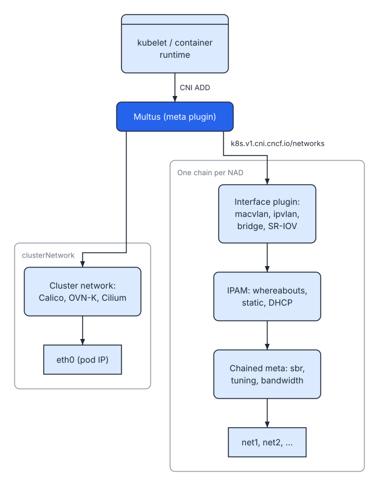
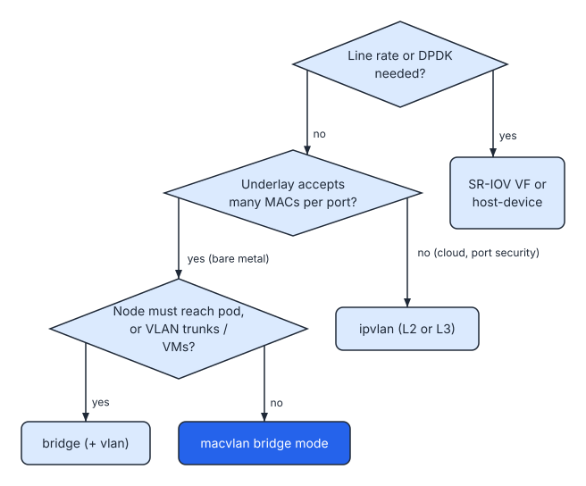

# Network Attachment Patterns

This section is a practical analysis of how Multus is configured in real clusters: which CNI plugins are combined behind a `NetworkAttachmentDefinition` (NAD), why, and what each combination costs you.

It complements the [Configuration reference](../configuration.md), which documents every Multus option, by answering a different question: **"which combination should I pick for my use case?"**

## How to read this section

| Page | What it answers |
| --- | --- |
| [Building blocks](building-blocks.md) | What each interface, IPAM and meta plugin does, in one place. |
| [Multus deployment options](deployment-options.md) | Thin vs thick, `clusterNetwork` vs `delegates`, namespace isolation, and other Multus-level choices. |
| [macvlan patterns](macvlan.md) | macvlan with whereabouts, static, DHCP and host-local; mode selection. |
| [ipvlan patterns](ipvlan.md) | ipvlan L2/L3 for MAC-restricted environments. |
| [bridge and VLAN patterns](bridge-vlan.md) | Linux bridge, VLAN tagging, trunks. |
| [SR-IOV and host-device patterns](sriov-host-device.md) | Hardware passthrough for high-performance workloads. |
| [Routing: default-route, sbr, route-override](routing.md) | How routes behave in a multi-homed pod and how to control them. |
| [Tuning, MAC, MTU and bandwidth](tuning.md) | Chained meta plugins that adjust an interface after creation. |
| [Comparison matrix](comparison-matrix.md) | All popular combinations side by side, with pros and cons. |
| [Pitfalls and troubleshooting](troubleshooting.md) | The mistakes that show up most often, and how to diagnose them. |

## The mental model in 60 seconds

<!-- svgdog mental-model
version: 1
theme: docs-auto
diagram: flow
direction: down
title: How Multus builds a multi-homed pod
description: The runtime calls Multus, which runs the cluster network for eth0 and one plugin chain per NetworkAttachmentDefinition for net1, net2 and so on.
nodes:
  - { id: runtime, label: kubelet / container runtime, kind: client }
  - { id: multus, label: Multus (meta plugin), kind: service, emphasis: true }
  - { id: cluster, label: "Cluster network: Calico, OVN-K, Cilium", kind: service }
  - { id: eth0, label: eth0 (pod IP), kind: box }
  - { id: iface, label: "Interface plugin: macvlan, ipvlan, bridge, SR-IOV", kind: service }
  - { id: ipam, label: "IPAM: whereabouts, static, DHCP", kind: service }
  - { id: meta, label: "Chained meta: sbr, tuning, bandwidth", kind: service }
  - { id: net1, label: "net1, net2, ...", kind: box }
groups:
  - { id: default, label: clusterNetwork, members: [cluster, eth0] }
  - { id: nad, label: One chain per NAD, members: [iface, ipam, meta, net1] }
edges:
  - "runtime -> multus: CNI ADD"
  - "multus -> cluster"
  - "cluster -> eth0"
  - "multus -> iface: k8s.v1.cni.cncf.io/networks"
  - "iface -> ipam"
  - "ipam -> meta"
  - "meta -> net1"
-->

* **eth0** always comes from the cluster (default) network. It carries the pod IP that Kubernetes Services, kube-proxy, NetworkPolicy and the API server know about.
* **Every secondary interface** is invisible to Kubernetes networking primitives. Services do not load-balance to it, standard NetworkPolicy does not filter it (see [multi-networkpolicy](https://github.com/k8snetworkplumbingwg/multi-networkpolicy)), and DNS does not resolve it.
* A NAD is just a CNI configuration. It can be a single plugin (`"type": "macvlan"`) or a **conflist** (`"plugins": [...]`) where meta plugins such as `sbr` or `tuning` are chained after the interface plugin.
* Every secondary attachment is made of three independent choices:
  1. **Interface plugin**: how the interface is created (macvlan, ipvlan, bridge, SR-IOV VF, host-device, vlan, OVS, ...).
  2. **IPAM plugin**: where the IP comes from (whereabouts, static, host-local, DHCP, none).
  3. **Meta plugins** (optional): what to change afterwards (routing tables, sysctls, MAC, bandwidth).

Most "which config should I use" questions become simple once you pick these three independently. That is the structure this section follows.

## Quick decision guide

Pick the interface plugin first:

<!-- svgdog choose-interface
version: 1
theme: docs-auto
diagram: flow
direction: down
title: Choosing the interface plugin
description: Line-rate needs lead to SR-IOV or host-device; MAC-restricted underlays lead to ipvlan; host-to-pod or VLAN trunk needs lead to bridge; everything else to macvlan.
nodes:
  - { id: perf, label: Line rate or DPDK needed?, kind: decision }
  - { id: mac, label: Underlay accepts many MACs per port?, kind: decision }
  - { id: host, label: "Node must reach pod, or VLAN trunks / VMs?", kind: decision }
  - { id: sriov, label: SR-IOV VF or host-device, kind: service, link: sriov-host-device.md }
  - { id: ipvlan, label: ipvlan (L2 or L3), kind: service, link: ipvlan.md }
  - { id: bridge, label: bridge (+ vlan), kind: service, link: bridge-vlan.md }
  - { id: macvlan, label: macvlan bridge mode, kind: service, emphasis: true, link: macvlan.md }
edges:
  - "perf -> sriov: yes"
  - "perf -> mac: no"
  - "mac -> ipvlan: no (cloud, port security)"
  - "mac -> host: yes (bare metal)"
  - "host -> bridge: yes"
  - "host -> macvlan: no"
-->

Then pick IPAM and routing independently:

| Need | IPAM |
| --- | --- |
| Cluster-wide unique dynamic IPs | whereabouts |
| Fixed IP per pod | static + `"ips"` capability |
| Existing DHCP server | dhcp (daemon on every node) |
| Single node / per-node subnets | host-local |

| Need | Routing |
| --- | --- |
| Replies must leave via the interface they came in on | sbr |
| All egress through the secondary network | `default-route` |
| Only specific prefixes via the secondary network | IPAM `routes` or route-override |

> **Note on "popularity".** Multus does not collect usage telemetry. The combinations called "most popular" in this section are those that dominate upstream examples and e2e tests (macvlan with host-local/static/whereabouts, SR-IOV with tuning), the Network Plumbing WG ecosystem projects, and vendor distributions (for example OpenShift's additional networks, telco 5G reference designs, KubeVirt). Treat the ranking as qualitative.
