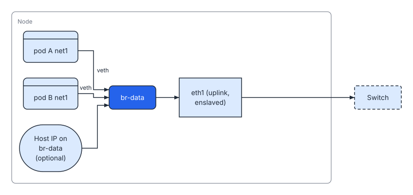

# bridge and VLAN patterns

## Linux bridge

The `bridge` plugin creates a Linux bridge on the node (or reuses one) and plugs each pod in with a veth pair. To reach the outside world, the physical uplink (or a VLAN sub-interface of it) must be enslaved to the bridge. The plugin does **not** do this for you; use NMState, `nmcli`, cloud-init, etc.

<!-- svgdog bridge-topology
version: 1
theme: docs-auto
diagram: flow
direction: right
title: Linux bridge on a node
description: Pods connect by veth pairs to the br-data bridge, which can hold a host IP and is enslaved to the eth1 uplink towards the switch.
nodes:
  - { id: pod-a, label: pod A net1, kind: client }
  - { id: pod-b, label: pod B net1, kind: client }
  - { id: host, label: Host IP on br-data (optional), kind: actor }
  - { id: br, label: br-data, kind: service, emphasis: true }
  - { id: eth1, label: "eth1 (uplink, enslaved)", kind: box }
  - { id: switch, label: Switch, kind: external }
groups:
  - { id: node, label: Node, members: [pod-a, pod-b, host, br, eth1] }
edges:
  - "pod-a -> br: veth"
  - "pod-b -> br: veth"
  - "host -> br"
  - "br -> eth1"
  - "eth1 -> switch"
-->




### Key options

| Option | Purpose |
| --- | --- |
| `bridge` | Bridge name (created if missing) |
| `isGateway` / `isDefaultGateway` | Give the bridge the gateway IP / make it the pod's default route |
| `ipMasq` | SNAT pod traffic leaving through the host |
| `vlan` | Access VLAN tag for the pod's port (requires `vlan_filtering` on the bridge) |
| `vlanTrunk` | Allowed VLAN list for a trunk port into the pod |
| `hairpinMode` | Allow a pod to reach itself through the bridge |
| `macspoofchk` | Drop frames whose source MAC isn't the pod's |
| `mtu` | veth MTU |

### Combination: bridge + whereabouts (+ vlan)

```yaml
apiVersion: k8s.cni.cncf.io/v1
kind: NetworkAttachmentDefinition
metadata:
  name: br-vlan100
spec:
  config: '{
    "cniVersion": "0.4.0",
    "type": "bridge",
    "bridge": "br-data",
    "vlan": 100,
    "macspoofchk": true,
    "ipam": {
      "type": "whereabouts",
      "range": "172.16.100.0/24",
      "gateway": "172.16.100.1"
    }
  }'
```

**Pros**
- **Host ↔ pod traffic works.** The bridge can hold a host IP, which fixes the macvlan limitation.
- VLAN access and trunk ports per pod from one bridge.
- This is the standard for **KubeVirt** VMs, which need a bridged L2 interface.
- `macspoofchk` gives basic anti-spoofing.

**Cons**
- veth plus bridge has more overhead than macvlan or ipvlan.
- The uplink and bridge must be pre-configured on every node, which adds host networking state to manage.
- Like macvlan, the switch sees one MAC per pod.
- No `master` validation: if `br-data` isn't enslaved to an uplink, pods only reach each other on that node.

### Combination: bridge, no uplink (node-local network)

Leave the bridge without an uplink and set `isGateway` plus `ipMasq` to give pods a private node-local network, for example sidecar-to-sidecar traffic or local test harnesses. It is simple and isolated, but has no cross-node connectivity.

## vlan plugin

The `vlan` plugin creates an 802.1Q sub-interface of `master` **directly inside the pod**.

```json
{
  "cniVersion": "0.4.0",
  "type": "vlan",
  "master": "eth1",
  "vlanId": 200,
  "ipam": { "type": "whereabouts", "range": "10.200.0.0/24" }
}
```

**Pros:** no bridge or host prep beyond a trunk on `eth1`, and the VLAN is selected per NAD.
**Cons:** **only one pod per node per VLAN**, because two VLAN sub-interfaces with the same ID can't share a parent, so it's rarely suitable for Deployments. For many pods per VLAN, prefer macvlan on a host VLAN sub-interface (`master: eth1.200`) or bridge with `vlan`.

## Popular VLAN strategies compared

| Strategy | Pods per node per VLAN | Host prep | Host ↔ pod |
| --- | --- | --- | --- |
| macvlan on host sub-interface `eth1.200` | Many | Create `eth1.200` on every node | No |
| bridge with `vlan: 200` + `vlan_filtering` | Many | Bridge + uplink | Yes (via host VLAN interface) |
| `vlan` plugin on `eth1` | **One** | Trunk only | No |
| SR-IOV VF with `vlan: 200` | Up to VF count | SR-IOV operator / device plugin | Via NIC eswitch |
