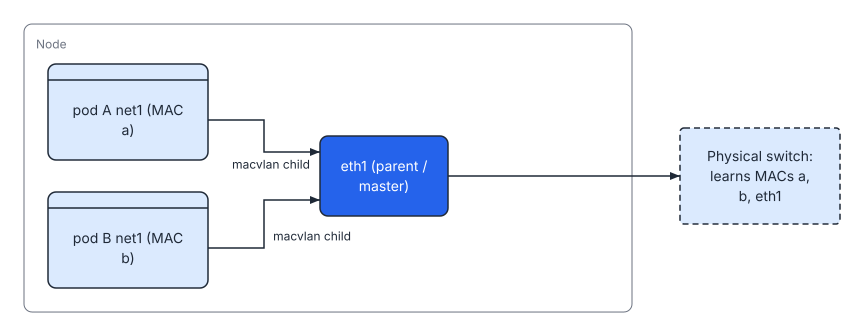

# macvlan patterns

macvlan is the most widely used secondary interface type with Multus. It appears in the upstream quickstart, most examples and the e2e tests. It gives each pod a virtual NIC with its **own MAC address** on the same L2 segment as a parent interface on the node.

<!-- svgdog macvlan-topology
version: 1
theme: docs-auto
diagram: flow
direction: right
title: macvlan on a node
description: Two pods get macvlan children of the parent eth1, each with its own MAC; the switch learns all three MACs, and the parent cannot reach its children.
nodes:
  - { id: pod-a, label: "pod A net1 (MAC a)", kind: client }
  - { id: pod-b, label: "pod B net1 (MAC b)", kind: client }
  - { id: eth1, label: eth1 (parent / master), kind: service, emphasis: true }
  - { id: switch, label: "Physical switch: learns MACs a, b, eth1", kind: external }
groups:
  - { id: node, label: Node, members: [pod-a, pod-b, eth1] }
edges:
  - "pod-a -> eth1: macvlan child"
  - "pod-b -> eth1: macvlan child"
  - "eth1 -> switch"
-->




## Key options

| Option | Default | Notes |
| --- | --- | --- |
| `master` | interface with the node's default route | Always set it explicitly. A wrong default silently puts pods on the management network. |
| `mode` | `bridge` | `bridge`, `vepa`, `private` or `passthru` (see below) |
| `mtu` | parent's MTU | Must be ≤ parent MTU |
| `linkInContainer` | `false` | Parent lives inside the pod's netns (nested setups) |
| `ipam` | — | See the combinations below |

### Modes

| Mode | Children can talk to each other on the same node | Use when |
| --- | --- | --- |
| `bridge` | Yes, switched in the kernel | **Default choice** |
| `vepa` | Only via an external switch with hairpin / reflective relay | You want the external switch to enforce policy |
| `private` | Never | Strict tenant isolation on the same node |
| `passthru` | Single child only | Giving one pod exclusive control of the parent |

## The host ↔ pod limitation

A macvlan parent **cannot** exchange traffic with its own children. This is a kernel design choice, not a Multus bug. The node, and therefore kubelet health probes and host-network pods, cannot reach `net1` of a local pod over `eth1`.

Workarounds:
1. Create a host-side macvlan "shim" interface on the same parent, give it an IP, and route the pod subnet through it.
2. Use a [bridge](bridge-vlan.md) instead.
3. Run probes against `eth0` (the cluster network), which is the usual answer.

## Combination 1: macvlan + whereabouts (most popular)

```yaml
apiVersion: k8s.cni.cncf.io/v1
kind: NetworkAttachmentDefinition
metadata:
  name: macvlan-whereabouts
spec:
  config: '{
    "cniVersion": "0.4.0",
    "type": "macvlan",
    "master": "eth1",
    "mode": "bridge",
    "ipam": {
      "type": "whereabouts",
      "range": "192.168.10.0/24",
      "range_start": "192.168.10.50",
      "range_end": "192.168.10.200",
      "exclude": ["192.168.10.100/30"],
      "gateway": "192.168.10.1"
    }
  }'
```

**Pros**
- Unique IPs across the whole cluster from one pool definition.
- Pods can be rescheduled to any node and still land in the same subnet.
- Supports IPv6, dual-stack and excluded ranges.

**Cons**
- whereabouts is another component to install and upgrade, and its CRDs need RBAC.
- Allocation needs the API server, so pod creation stalls if the API is slow.
- Leaked reservations after node crashes need the ip-reconciler cronjob.
- Inherits the macvlan limitations: no host ↔ pod traffic, and the switch must accept many MACs.

**Choose when:** you want "pods on my VLAN with dynamic IPs" and don't have DHCP. This is the general-purpose answer.

## Combination 2: macvlan + static (+ tuning for MAC)

A fixed IP and optional fixed MAC per pod, requested in the pod annotation:

```yaml
apiVersion: k8s.cni.cncf.io/v1
kind: NetworkAttachmentDefinition
metadata:
  name: macvlan-static
spec:
  config: '{
    "cniVersion": "0.4.0",
    "name": "macvlan-static",
    "plugins": [
      {
        "type": "macvlan",
        "master": "eth1",
        "mode": "bridge",
        "capabilities": { "ips": true },
        "ipam": {
          "type": "static",
          "routes": [ { "dst": "10.20.0.0/16", "gw": "192.168.10.1" } ]
        }
      },
      { "type": "tuning", "capabilities": { "mac": true } }
    ]
  }'
---
apiVersion: v1
kind: Pod
metadata:
  name: legacy-gw
  annotations:
    k8s.v1.cni.cncf.io/networks: '[{
      "name": "macvlan-static",
      "ips": ["192.168.10.21/24"],
      "mac": "02:00:00:10:00:21"
    }]'
```

**Pros**
- Deterministic addressing for firewall allow-lists, licensing tied to a MAC, or legacy peers.
- No IPAM component and no API dependency during allocation.

**Cons**
- Uniqueness is your problem. Two pods with the same IP cause ARP flapping.
- It doesn't fit Deployments with `replicas > 1` without per-replica tooling such as StatefulSet plus a templating admission webhook.
- If `"capabilities": {"ips": true}` is missing, the `ips` field is silently ignored.

**Choose when:** you run singletons or StatefulSets that must keep a well-known address.

## Combination 3: macvlan + DHCP

```json
{
  "cniVersion": "0.4.0",
  "type": "macvlan",
  "master": "eth1",
  "mode": "bridge",
  "ipam": { "type": "dhcp" }
}
```

You also need the CNI DHCP daemon on every node, typically as a DaemonSet running `/opt/cni/bin/dhcp daemon`.

**Pros**
- Reuses enterprise IPAM, DNS registration and reservations.
- Gives a per-MAC fixed IP via DHCP reservations when combined with the `mac` capability.

**Cons**
- One more DaemonSet. If it isn't running, pod creation fails or leases expire.
- Pod start latency depends on the DHCP server.
- The DHCP server must be reachable on that L2 segment (or through a relay).

**Choose when:** the network team already owns DHCP for that VLAN and wants pod addresses to show up there.

## Combination 4: macvlan + host-local (per-node ranges)

This is used in upstream examples because it needs nothing extra.

**Pros:** zero dependencies, fast.
**Cons:** you must give **each node a distinct range**, because the same NAD config on all nodes creates duplicate IPs across nodes. That forces per-node config files (NAD without `spec.config` plus `/etc/cni/multus/net.d/*.conf` on each node), which doesn't scale.
**Choose when:** you run single-node clusters, labs or CI.

## Combination 5: macvlan + whereabouts + sbr

This makes pods reachable from outside the cluster on `net1` while keeping `eth0` as the default route. See [Routing](routing.md#2-sbr-source-based-routing) for the full explanation and config.

## Environment compatibility

| Environment | macvlan works? | Notes |
| --- | --- | --- |
| Bare metal, access ports | Yes | Watch switch MAC-per-port limits and port security |
| VMware vSwitch | With tweaks | Enable promiscuous mode and forged transmits, or use "MAC learning" on the port group |
| KVM / libvirt bridge | Yes | |
| OpenStack (Neutron port security) | Only with allowed-address-pairs or port security disabled | Otherwise use ipvlan |
| AWS / Azure / GCP VPC | **No** | Unknown MACs are dropped. Use ipvlan or cloud-native ENI/NIC solutions |
| Wi-Fi parent | **No** | 802.11 does not support multiple MACs per station |
