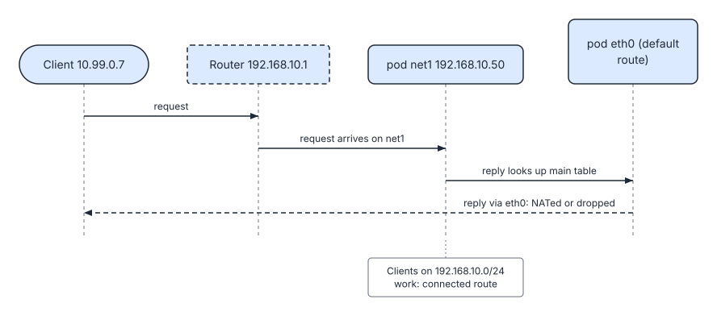
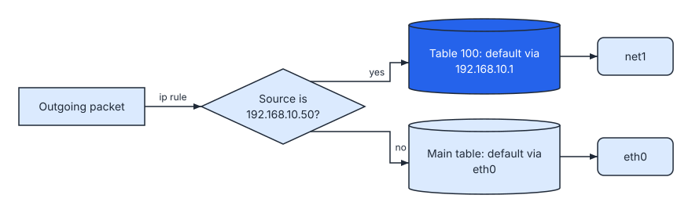

# Routing in multi-homed pods: default-route, sbr, route-override

Routing is where most multi-network designs go wrong. A pod with `eth0` and `net1` has **one** main routing table. By default the cluster network owns the default route. Anything not covered by a more specific route leaves via `eth0`, even if the packet's source IP belongs to `net1`.

## The asymmetric routing problem

<!-- svgdog asymmetric
version: 1
theme: docs-auto
diagram: sequence
title: Asymmetric routing without sbr
description: A client on another subnet reaches the pod through the router on net1, but the pod's reply follows the main default route out of eth0 and is dropped or NATed.
nodes:
  - { id: client, label: Client 10.99.0.7, kind: actor }
  - { id: router, label: Router 192.168.10.1, kind: external }
  - { id: net1, label: pod net1 192.168.10.50, kind: service }
  - { id: eth0, label: pod eth0 (default route), kind: service }
edges:
  - "client -> router: request"
  - "router -> net1: request arrives on net1"
  - "net1 -> eth0: reply looks up main table"
  - { from: eth0, to: client, label: "reply via eth0: NATed or dropped", style: async }
notes:
  - { attach: net1, text: "Clients on 192.168.10.0/24 work: connected route" }
-->




There are four ways to fix this, in increasing order of scope.

## 1. Specific routes in IPAM (simplest)

If remote clients live in known prefixes, add routes to the NAD:

```json
"ipam": {
  "type": "whereabouts",
  "range": "192.168.10.0/24",
  "routes": [ { "dst": "10.99.0.0/16", "gw": "192.168.10.1" } ]
}
```

**Pros:** explicit, easy to reason about, and the cluster default route is untouched.
**Cons:** you must know every remote prefix in advance, and a change means editing the NAD and restarting pods.

## 2. sbr: source-based routing

The `sbr` meta plugin, chained after the interface plugin:
1. Creates a new routing table for the interface. Table IDs start at 100 by default; recent versions accept an explicit `table`.
2. **Moves** the interface's routes, including its gateway (default) route if IPAM returned one, from the main table into that table.
3. Adds a policy rule: `from <net1 IP> lookup <table>`.

<!-- svgdog sbr-lookup
version: 1
theme: docs-auto
diagram: flow
direction: right
title: Route lookup with sbr
description: A packet sourced from net1's IP matches the sbr rule and uses table 100, which leaves via net1's gateway; every other packet falls through to the main table and leaves via eth0.
nodes:
  - { id: pkt, label: Outgoing packet, kind: box }
  - { id: rule, label: "Source is 192.168.10.50?", kind: decision }
  - { id: t100, label: "Table 100: default via 192.168.10.1", kind: datastore, emphasis: true }
  - { id: main, label: "Main table: default via eth0", kind: datastore }
  - { id: net1, label: net1, kind: service }
  - { id: eth0, label: eth0, kind: service }
edges:
  - "pkt -> rule: ip rule"
  - "rule -> t100: yes"
  - "rule -> main: no"
  - "t100 -> net1"
  - "main -> eth0"
-->



The result: traffic **sourced from net1's IP** uses net1's table, including its own default gateway. All other traffic keeps using the main table, so `eth0` remains the pod's default route.

```yaml
apiVersion: k8s.cni.cncf.io/v1
kind: NetworkAttachmentDefinition
metadata:
  name: macvlan-sbr
spec:
  config: '{
    "cniVersion": "0.4.0",
    "name": "macvlan-sbr",
    "plugins": [
      {
        "type": "macvlan",
        "master": "eth1",
        "mode": "bridge",
        "ipam": {
          "type": "whereabouts",
          "range": "192.168.10.0/24",
          "gateway": "192.168.10.1",
          "routes": [ { "dst": "0.0.0.0/0" } ]
        }
      },
      { "type": "sbr" }
    ]
  }'
```

Inside the pod:

```
$ ip rule
0:      from all lookup local
32765:  from 192.168.10.50 lookup 100
32766:  from all lookup main
$ ip route show table 100
default via 192.168.10.1 dev net1
192.168.10.0/24 dev net1 proto kernel scope link src 192.168.10.50
$ ip route            # main table untouched: eth0 still default
default via 10.244.1.1 dev eth0
...
```

**Pros**
- Fixes asymmetric routing for **inbound** connections on the secondary network without knowing remote prefixes.
- Keeps `eth0` as the default for cluster traffic, DNS and the API, so Kubernetes functionality is unaffected.
- Several secondary networks, each with its own sbr table, can coexist, for example multi-homed appliances on a management, signalling and media network.

**Cons**
- **Outbound** connections the application starts are routed by the main table unless the app binds to net1's IP. The kernel picks the source address after route lookup.
- Moving the connected-subnet route into the table can surprise tooling that inspects only the main table.
- Requires a conflist NAD (chaining). It does not work with a single-plugin config.
- Rules are per IP, so many IPs on one interface means many rules.

**Choose when:** the pod is a **server** on the secondary network, reached from arbitrary or routed clients. This is common for telco network functions, load balancers and DNS/NTP appliances exposed on a provider VLAN.

## 3. `default-route` in the network selection annotation

This moves the pod's default gateway to a secondary attachment:

```yaml
k8s.v1.cni.cncf.io/networks: '[{"name": "macvlan-conf", "default-route": ["192.168.10.1"]}]'
```

What Multus actually does, from `pkg/multus/multus.go` and `pkg/types/conf.go`:
1. Only **one IPv4 and one IPv6** `default-route` are allowed across all attachments of a pod. More than that is rejected with `multus does not support ECMP for default-route`.
2. When any attachment requests `default-route`, Multus **deletes every default route from every other interface, including `eth0`**, after each plugin runs, and also edits the cached results.
3. It then adds `default via <gw> dev <ifname>` on the chosen interface. The gateway must be on-link (inside the interface's subnet), or route creation fails.
4. The deletion on non-selected interfaces ignores address family. Overriding only the IPv4 default therefore also removes `eth0`'s **IPv6** default route in a dual-stack cluster.

**Pros**
- One-line, per-pod control with no NAD change: the same NAD can be used with or without it.
- All egress, including connections the app starts, uses the secondary network.

**Cons**
- Cluster egress needs more specific routes via `eth0` to keep working: Service CIDR, pod CIDR, API server and DNS. The Service CIDR route usually isn't installed by the primary CNI, so **ClusterIP Services can break**. Add explicit routes, for example via `route-override` or IPAM routes on the cluster network.
- Easy to break node-local health probes in some CNIs.
- No ECMP across attachments.

**Choose when:** the workload is an egress gateway, a VNF or a VPN client whose whole external traffic must use the provider network, and you have verified cluster-internal reachability.

## 4. route-override

The `route-override` meta plugin edits routes produced by IPAM without changing the IPAM plugin:

```json
{ "type": "route-override",
  "flushgateway": true,
  "delroutes": [ { "dst": "192.168.0.0/16" } ],
  "addroutes": [ { "dst": "10.99.0.0/16", "gw": "192.168.10.1" } ] }
```

**Pros:** works with any IPAM, including DHCP whose routes you can't control, and can strip an unwanted gateway.
**Cons:** another plugin binary to ship on every node, and routes are still in the main table.

## 5. VRF (strong isolation)

The `vrf` meta plugin puts the interface into a Linux VRF inside the pod. Use it when two attachments have **overlapping subnets**, or when the app is VRF-aware (binds with `SO_BINDTODEVICE`).
- **Pros:** complete separation of routing tables.
- **Cons:** apps must be VRF-aware.

## Decision table

| Need | Use |
| --- | --- |
| Reach a few known remote subnets via net1 | IPAM `routes` |
| Pod is a server on net1, replies must go back via net1 | **sbr** |
| All egress via net1 | `default-route` (+ cluster routes on eth0) |
| IPAM gives bad routes / gateway you can't change | `route-override` |
| Overlapping subnets across attachments | `vrf` |
| Strict rp_filter on the secondary interface | sbr, or `tuning` with `rp_filter=2` (loose) |
