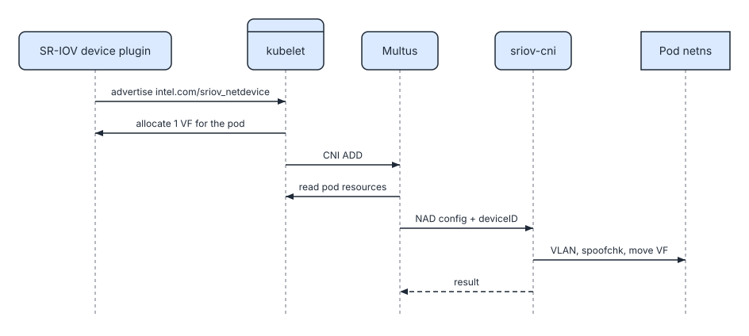

# SR-IOV and host-device patterns

These patterns hand real hardware to the pod. They are the dominant choice for telco (5G core, RAN), NFV, trading and HPC workloads.

## SR-IOV

An SR-IOV NIC exposes many **Virtual Functions** (VFs). Each VF behaves like an independent PCIe NIC. Moving a VF into the pod bypasses the host kernel's software switching completely.

<!-- svgdog sriov-stack
version: 1
theme: docs-auto
diagram: sequence
title: Attaching an SR-IOV VF
description: The device plugin advertises VFs, kubelet allocates one to the pod, Multus maps it to the NAD by resourceName and passes the deviceID to sriov-cni, which moves the VF into the pod.
nodes:
  - { id: dp, label: SR-IOV device plugin, kind: service }
  - { id: kubelet, label: kubelet, kind: client }
  - { id: multus, label: Multus, kind: service }
  - { id: cni, label: sriov-cni, kind: service }
  - { id: pod, label: Pod netns, kind: box }
edges:
  - "dp -> kubelet: advertise intel.com/sriov_netdevice"
  - "kubelet -> dp: allocate 1 VF for the pod"
  - "kubelet -> multus: CNI ADD"
  - "multus -> kubelet: read pod resources"
  - "multus -> cni: NAD config + deviceID"
  - "cni -> pod: VLAN, spoofchk, move VF"
  - { from: cni, to: multus, label: result, style: async }
-->



The full stack has three parts:
1. The **SR-IOV Network Device Plugin** advertises VFs as extended resources, for example `intel.com/sriov_netdevice`.
2. The **NAD** carries the annotation `k8s.v1.cni.cncf.io/resourceName`, so Multus can map the allocated device to the attachment and pass `deviceID` to the plugin. See [Device resource assignment](../device-resource-assignment.md).
3. The **sriov-cni** plugin configures the VF (VLAN, spoof check, trust, rate) and moves it into the pod.

Clusters with Dynamic Resource Allocation can use a DRA driver instead of the device plugin. See the DRA section in [How to use](../how-to-use.md).

### Combination: SR-IOV (kernel netdev) + whereabouts + tuning

```yaml
apiVersion: k8s.cni.cncf.io/v1
kind: NetworkAttachmentDefinition
metadata:
  name: sriov-data
  annotations:
    k8s.v1.cni.cncf.io/resourceName: intel.com/sriov_netdevice
spec:
  config: '{
    "cniVersion": "0.4.0",
    "name": "sriov-data",
    "plugins": [
      {
        "type": "sriov",
        "vlan": 300,
        "spoofchk": "on",
        "trust": "off",
        "ipam": { "type": "whereabouts", "range": "10.30.0.0/24" }
      },
      {
        "type": "tuning",
        "capabilities": { "mac": true },
        "sysctl": { "net.ipv4.conf.IFNAME.arp_ignore": "1" }
      }
    ]
  }'
```

The pod must also **request the resource** in its container spec:

```yaml
resources:
  requests: { intel.com/sriov_netdevice: "1" }
  limits:   { intel.com/sriov_netdevice: "1" }
```

**Pros**
- Near line-rate throughput, lowest latency and jitter, and minimal host CPU use.
- Per-VF hardware VLAN, QoS, rate limiting and spoof checking.
- The scheduler knows about VF capacity through extended resources.

**Cons**
- Needs SR-IOV-capable NICs, BIOS/IOMMU settings and VFs created per node. Usually you run the SR-IOV Network Operator.
- VF count is finite, typically 8–128 per port.
- Live migration and pod moves are harder; NIC firmware and driver versions matter.
- VF-to-VF traffic on the same NIC is switched in hardware and bypasses host iptables. Policy needs multi-networkpolicy with an SR-IOV-aware implementation.
- More components can fail: the device plugin, the resource name, the NAD annotation and the request must all line up.

### Combination: SR-IOV (vfio-pci) for DPDK, no IPAM

The VF is bound to `vfio-pci` and the application (DPDK, VPP) drives it from user space. There is no kernel netdev, so set IPAM to `{}`. The application gets the PCI address from the device-info file or the `network-status` annotation.

**Pros:** maximum packet rate.
**Cons:** the application must handle addressing, ARP and so on itself; it needs hugepages; it is invisible to standard Linux tooling.

## host-device

`host-device` moves an **existing** host interface into the pod's netns, selected by `device`, `hwaddr`, `kernelpath` or `pciBusID`, or by `deviceID` from a device plugin. On pod deletion the interface is returned to the host.

```json
{
  "cniVersion": "0.4.0",
  "type": "host-device",
  "device": "ens3f1",
  "ipam": { "type": "static", "addresses": [ { "address": "10.40.0.10/24" } ] }
}
```

**Pros**
- No SR-IOV needed. Any NIC works, including non-SR-IOV 25/100G NICs, InfiniBand and CAN.
- Full NIC performance and features inside the pod.

**Cons**
- **One pod per device.** Without a device plugin the scheduler is unaware, so a second pod on that node fails at CNI ADD.
- Interface names are node-specific. Pair it with node selectors, or use a device plugin with `deviceID`.
- If the pod or node crashes, the interface may be left in a stale netns until cleanup.

**Choose when:** you have a dedicated NIC for one workload per node, for example a packet capture appliance, a storage initiator or a specialised gateway.
